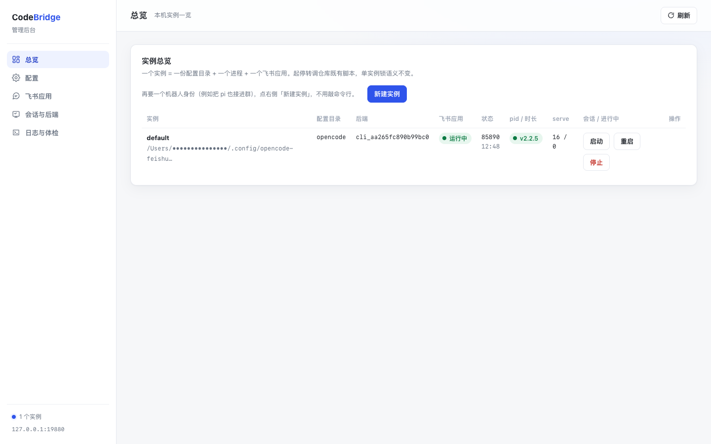
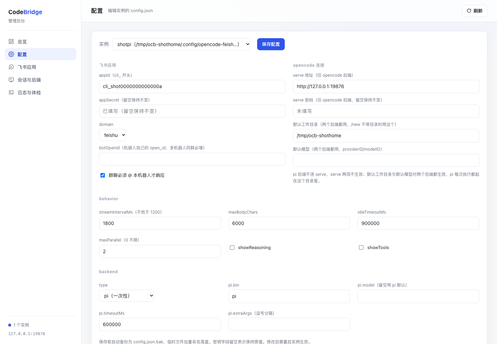
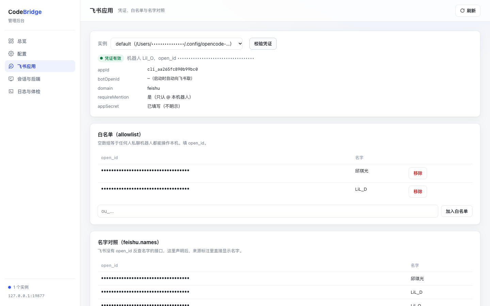
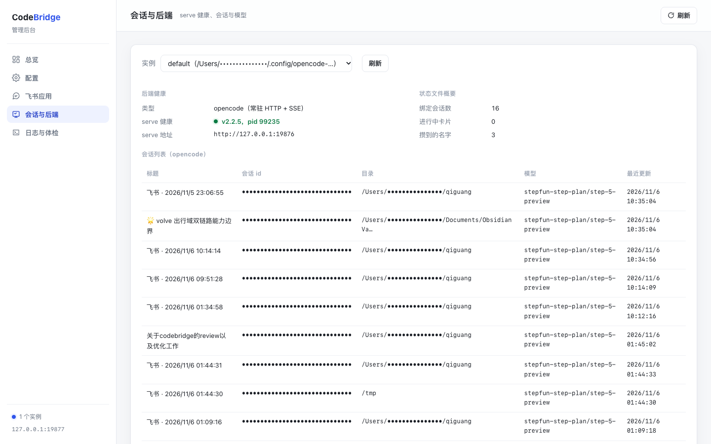
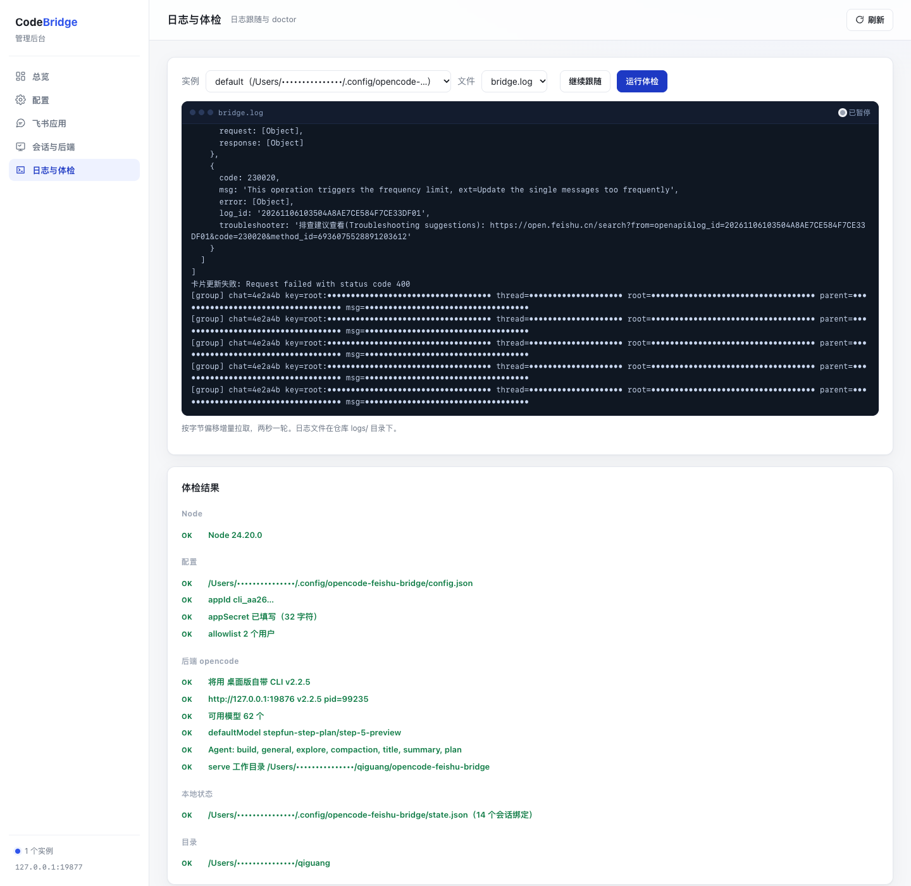
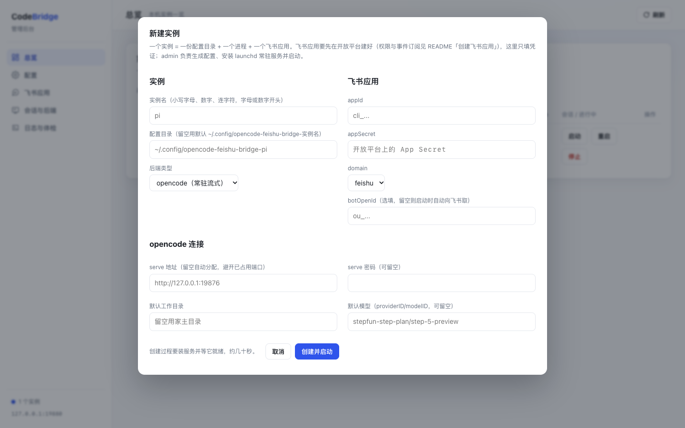

# opencode ⇄ 飞书 桥接

把本机运行的 [opencode](https://opencode.ai) 接到飞书机器人上。在飞书里发一句话，本机 opencode 在你的项目目录里干活，过程和结果流式推回一张飞书卡片。后端可替换，也能把 `pi` 这类一次性 CLI 接成另一个机器人。

适合：agent 装在自己电脑上，想在外面用手机派活、看结论的人；以及想让多个本机 agent 在同一个飞书群里分工协作的人。
不适合：需要云端执行沙箱的场景。

---

## 能力

| 能力 | 说明 |
|---|---|
| 远程下任务 | 飞书里发一句话，本机 opencode 在指定项目目录执行 |
| 多会话 | `/sessions` 出列表点按钮切；`/new` 开新任务。会话按目录隔离 |
| 实时进度 | 卡片流式更新：正文、步数、token、耗时、成本 |
| 富文本 | markdown 表格渲染成真表格，代码块带语法高亮 |
| 权限审批 | opencode 要读 `.env`、动敏感文件时，飞书弹卡片，点允许一次/总是/拒绝 |
| 模型切换 | `/model` `/agent` 在线换，不用重启 |
| 多项目 | `/cd` 换目录，每个目录一份独立会话列表 |
| 群里并行 | 群里每 @ 它一次就在下面开一条话题，一条话题一个会话，多条话题同时跑；只响应 @ 它自己的消息 |
| 免公网 | 走长连接，不需要公网 IP、不需要内网穿透 |
| 可换后端 | `backend.type` 选 `opencode`（常驻服务 + SSE 流式）或 `pi`（一次性子进程，边跑边把进度翻译成同一套事件）；同一套卡片、中止、僵尸卡收尾逻辑 |

---

## 它长什么样

同一套交互的两个切面。

**左**：发一句话 → 卡片流式回结果。中间那张表是**模型输出的 markdown 表格**，被渲染成了飞书原生表格组件（不是文字）。<br>
**右**：`/cd` 换目录后 `/sessions` 出列表，点「切换」换会话，历史回复原封不动。

<table>
<tr>
<td valign="top"><br>
卡片顶部一行元信息：<b>目录</b> / <b>模型</b> / <b>耗时</b> / <b>步数</b>；底部一行用量：<code>in</code> / <code>out</code> / <code>$</code>。工具调用链路默认不显示，只看结论；正文只保留最新一段叙述，中间过程的过程记录不拼接。</td>
<td valign="top"><br>
会话按目录隔离，列表中只出现当前目录下的会话。每条后面有「已用时长 · 模型 · 累计成本」，点「切换」后新发一条确认卡片。</td>
</tr>
</table>

---

## 快速开始

需要 Node.js 20+，以及装好的 **OpenCode 桌面版**（<https://opencode.ai>）。桥接会用桌面版自带的那份 CLI。

```bash
git clone <这个仓库> && cd opencode-feishu-bridge
npm install
```

`npm install` 只需跑一次。忘了跑也能进下一步（`init` 会跳过凭证验证并提醒你），但启动前必须装。

不需要另外 `npm i -g opencode`。装过的话建议卸掉——两份 opencode 共用同一个会话数据库，混着用会让某些会话突然读不出历史：

```bash
which opencode && npm rm -g @opencode/cli
```

> 为什么用桌面版自带的：桌面版和它的 CLI 是同一个版本、写同一个数据库。混用两个版本会出现「一个版本写入、另一个版本读不出来」，表现为某些会话突然发不出消息。详见 [docs/design-notes.md](docs/design-notes.md#八用哪个-opencode版本一致性)。

### 1. 确认用哪份 opencode

serve 由 `./scripts/up.sh` 自动拉起（第 5 步），它会按这个顺序挑二进制：

```
OPENCODE_BIN 环境变量  →  桌面版自带 CLI  →  PATH 里的 opencode
```

看一眼会选中哪个：

```bash
node scripts/which-opencode.mjs --json
```

如果你的 opencode 不在上述位置，用 `OPENCODE_BIN=/path/to/opencode` 指定即可。

想手动起 serve 也可以（调试用，注意密码要和配置里一致）：

```bash
# "$(node scripts/which-opencode.mjs)" 拿到的就是 up.sh 会用的那份
OPENCODE_SERVER_PASSWORD='my-secret-123' \
  "$(node scripts/which-opencode.mjs)" serve --port 19876 --hostname 127.0.0.1
```

验证：

```bash
curl -s -u opencode:my-secret-123 http://127.0.0.1:19876/api/info
# {"version":"2.2.5","pid":12345,...}
```

> 端口要和配置里的 `opencode.url` 对上，用 4096 也行，改配置即可。

### 2. 创建飞书应用

打开 <https://open.feishu.cn/app> → **创建企业自建应用**（名字随便，比如 `opencode`）。

**2.1 添加机器人能力** ｜ 「添加应用能力」→ 机器人 → 启用。

**2.2 加权限** ｜ 「开发配置 → 权限管理」→ 搜索并添加：

| 权限 | 用途 |
|---|---|
| `im:message` | 收发消息（含更新卡片） |
| `im:message:send_as_bot` | 以应用身份发消息 |
| `im:message.p2p_msg:readonly` | 读用户私聊机器人的消息 |
| `im:message.group_at_msg:readonly` | 读群里 @机器人 的消息 |
| `im:chat:readonly` | 可选，读群信息 |

**2.3 事件订阅** ｜ 「开发配置 → 事件与回调 → 事件配置」→ 订阅方式选 **使用长连接接收事件** → 添加 `im.message.receive_v1`（接收消息）。

**2.4 卡片回调** ｜ 同一页面切到 **「回调配置」** tab → 订阅方式选 **使用长连接接收回调** → 添加 `card.action.trigger`（卡片回传交互）。

> 有些版本的界面把这一项放在「事件配置」里，名字叫「卡片回传交互」，效果一样。**漏了这一步，卡片上的按钮会一直转圈没反应。**

**2.5 发布** ｜ 「版本管理与发布」→ 创建版本 → 申请发布。

- 企业自建应用通常需要管理员审批，通过后机器人才可用。
- 权限变更后必须**重新发版**才生效。

**2.6 拿凭证** ｜ 「凭证与基础信息」→ 复制 **App ID**（`cli_` 开头）和 **App Secret**。

### 配置放在哪

配置目录按这个顺序找，第一个命中的生效：

| 优先级 | 位置 | 什么时候用 |
|---|---|---|
| 1 | `$OCB_CONFIG_DIR` | 一台机器跑多个 agent，每个指一份 |
| 2 | `~/.config/opencode-feishu-bridge/` | 默认位置，所有入口都读它 |

只有这两条，没有「项目内 `.config/`」。配置统一放家目录，理由有三：appSecret
不落在仓库工作树里；换个目录、换个 clone 启动都读同一份；多实例时几个机器人
的配置排在一起，一眼看得清。

目录长这样：

```
~/.config/opencode-feishu-bridge/
├── config.json      ← 你的配置（含 appSecret）
├── state.json       ← 会话绑定、攒到的名字、未收尾的卡片
└── bridge.lock      ← 单实例锁
```

> ⚠️ **这个目录在仓库外，`.gitignore` 仍排除 `.config/` 作为第二道防线。** 万一有人把配置放回仓库，这条规则能挡住误入库。永远不要 `git add -f`——appSecret 推上去等于把机器人交给所有人。

这三个文件 clone 下来一个都没有，全都是本机生成的，谁生成、干什么用：

| 文件 | 谁生成 | 什么时候 | 为什么不能入库 |
|---|---|---|---|
| `config.json` | `npm run init`（漏了的话首次 `npm start` 也会生成） | 初始化时 | 含 `appSecret` |
| `state.json` | 桥接自己，第一次有会话绑定时写 | 用完第一次对话 | 里面的 `sessionId` 指向**本机** opencode 的会话，攒到的名字是**本应用**下的 `open_id`，换台机器/换个应用全是废数据 |
| `bridge.lock` | 桥接自己，启动时写、退出时删 | 每次启动 | 里面只有一个 pid。入库后新机器上可能撞上一个活着的 pid，直接被判成「已有实例在跑」而拒绝启动 |

所以 clone 完只剩一件事要做：`npm run init` 填凭证。其余两个文件你不用管，桥接会自己建。

**配置不在仓库里，clone 下来看不到它是正常的**，不是漏了文件。模板单独放在仓库根的 `config.example.json`（不含任何真实密钥、可安全入库），用一条命令铺开：

```bash
npm run init                                        # 铺到 ~/.config/opencode-feishu-bridge
npm run init -- --app-id=cli_xx --app-secret=yy     # 顺手把凭证填好
```

已经存在 `config.json` 时它不会覆盖，只提示；确实要重来加 `--force`，会先备份成 `config.json.bak`。

思路是「结构入库、密钥不入库」：目录结构和每个字段的含义需要有人告诉你，`config.example.json` 承担这件事；而 `appSecret` 和 `state.json` 只属于这台机器，一个字节都不进仓库。

三个入口（`npm start`、`scripts/*.sh`、`scripts/probe-*.mjs`）用的是同一套解析规则，不会出现「命令读 A、桥接读 B」的情况。

### 3. 填配置

```bash
npm run init
```

在终端里跑会进交互向导，问四个问题：

```
App ID: cli_aa265fc890b99bc0
App Secret: ****
验证凭证… ✅ Lil_O
   机器人 open_id ou_26dd…（自动填进 feishu.botOpenId）
你自己的 open_id（可留空，留空则谁私聊机器人都能用）: ou_4c8f…
默认工作目录: /Users/you
```

三件手工做很烦的事它替你做了：

- **输完立刻验证凭证**。填错当场报 `code=10003` 并提示「App ID 和 App Secret 别贴反」，不用等第一次发消息才发现。
- **自动填 `feishu.botOpenId`**。多机器人同群时靠它分辨「@ 的是不是我」，取不到就会退化成「@ 谁都算」，互相抢答。
- **顺手写白名单**。省掉「先跑起来、看日志、再回来改 JSON」那一圈。

不想交互（CI、脚本），用参数：

```bash
npm run init -- --app-id=cli_xx --app-secret=yy   # 只问剩下的
npm run init -- --no-input                        # 只铺模板，什么都不问
```

拿到 open_id 时配置往往已经存在了，为加一个 id 重跑向导太蠢，所以单独给了个命令：

```bash
npm run init -- --add-allow=ou_你的openid
```

生成的 `config.json` 长这样（也可以直接编辑它）：

```json
{
  "feishu": {
    "appId": "cli_a1b2c3d4e5f6g7h8",
    "appSecret": "你的 App Secret",
    "domain": "feishu",
    "allowlist": ["ou_你的open_id"],
    "requireMention": true,
    "botOpenId": "ou_机器人自己的open_id"
  },
  "opencode": {
    "url": "http://127.0.0.1:19876",
    "password": "my-secret-123",
    "defaultDirectory": "/Users/you/project",
    "defaultModel": "stepfun-step-plan/step-5-preview"
  },
  "behavior": {
    "streamIntervalMs": 1800,
    "showReasoning": false,
    "showTools": false,
    "maxBodyChars": 6000,
    "idleTimeoutMs": 900000
  }
}
```

两个必填项：

- **`defaultModel` 一定要填**，格式 `providerID/modelID`。opencode 的默认模型多是 free 模型，部分地区会报 `RegionError: This model is not available in your country`。

  列出可用模型：

  ```bash
  curl -s -u opencode:my-secret-123 http://127.0.0.1:19876/api/model \
    | python3 -c "import sys,json;[print(f\"{m['providerID']}/{m['id']}\") for m in json.load(sys.stdin)['data']]"
  ```

  `npm run doctor` 会校验你填的这个在不在列表里。

- **`allowlist` 强烈建议填**。空数组等于谁私聊机器人都能操作本机的 shell 和文件。填自己的 `open_id`，获取方法：先留空跑起来，给机器人发条消息，控制台日志里会打印「拒绝非白名单用户」，从里面拿到 id，然后用一条命令加进去——不用再去编辑 JSON：

  ```bash
  npm run init -- --add-allow=ou_你的openid
  ```

  向导里也可以直接填，就不用跑这两步。起了管理后台（下文）之后，「飞书应用」页也能加，还能顺手填名字。

### 4. 体检

```bash
npm run doctor
```

检查 Node 版本、配置完整性、opencode 连通性、模型是否在列表里、默认目录是否存在。全绿再往下。

### 5. 启动

推荐装成系统服务（登录自启、挂了自动拉起、不依赖任何终端）：

```bash
./scripts/install-agent.sh     # 装一次，之后开机就在跑
./scripts/status.sh            # 看状态：谁在跑、跑了多久、最近日志
./scripts/up.sh                # 重启（作用于 launchd 里的服务）
./scripts/down.sh              # 暂停（下次 up.sh 或下次登录会再起）
./scripts/uninstall-agent.sh   # 彻底卸掉
```

不想装服务也行，老办法照旧：

```bash
./scripts/up.sh       # 启动：同时拉起 serve + 桥接，nohup 后台常驻，写 pid 文件
./scripts/down.sh     # 停止：两个一起停
```

`up.sh` / `down.sh` 会自动识别有没有装 agent，两种模式都能用。

`up.sh` 会读配置里的 `password` 用同样的密码起 serve，不用手动对齐两边。

调试时也可以前台跑，能看到全部日志：

```bash
npm start
```

看到 `✅ 桥接已就绪` 后，飞书里搜机器人名字，私聊发 `/help`。

> **桌面版 App 不需要一直开着。** 桥接用的是 App 装在磁盘上的那份 `opencode-cli`（`~/Library/Application Support/ai.opencode.desktop/cli/<版本>-arm64/`），不是 App 的进程。两个进程各跑各的，实测桥接链路和 App 的 `serve --service` 之间没有任何连接。关掉 App 照样能在飞书里派活；只有在你想亲眼看着它执行、或者接着聊同一个会话时，才需要打开 App。
>
> 反过来要注意：升级桌面版之后，新版本的 CLI 在**新目录**里，正在跑的旧进程不会自己换。`./scripts/down.sh && ./scripts/up.sh` 一次即可。

> **为什么建议用 `install-agent.sh`。** `nohup` 起的进程还挂在某个 shell 的进程组里，那个 shell 退出时可能被一起收掉——表现就是「用着用着机器人不说话了，日志里连报错都没有」。装成 launchd agent 之后，进程归 launchd 管：登录自动起、被杀自动起（实测 kill -9 后 10 秒内恢复），关终端、退出 WorkBuddy 都不影响。

> **不要同时跑两个桥接进程。** 有单实例锁（配置目录下的 `bridge.lock`），第二个会直接报错退出——否则同一条消息会被回两遍。

---

## 怎么用

**一条请求 = 一条消息，只增不改。**

| 你的操作 | 消息怎么动 |
|---|---|
| 发一条消息 | 新开一张卡片承载这次执行，流式在**这张卡内部**更新 |
| 点「会话列表」 | **新发**一条列表卡片，原来那条回复原封不动 |
| 点「切换」/「新会话」/「授权」 | **新发**一条结果卡片，历史回复不动 |
| 在列表里翻页 | 只更新列表卡片自己 |

历史回答永远不会被按钮操作顶掉。卡片内部的流式刷新是例外——那是同一条消息的进度更新。

同一个会话同时只跑一个任务。上一条还在执行时再发消息会被挡回来，提示先等它结束或 `/stop`。

### 群里：一条话题一个会话

私聊只有一个会话，串行就够了。群里按话题拆：

- 在群里 @机器人 发一句话 → 它就在**这条消息下面开一条话题**回复，并为这条话题建一个独立会话
- 再 @ 一条新消息 → 又是一条新话题、又一个会话，两条可以同时跑
- 话题里继续说话**仍然每句都要 @它**，但会接在同一个会话上，不会跑到别的会话去
- 每条话题的 `/new` `/switch` `/stop` 只影响自己这条

相当于在群里开任意多个「并行工作台」，互不串上下文。整机有并发上限 `behavior.maxParallel`（默认 2），超了会直接告诉你当前有几个在跑。

#### @ 判定：只认「@ 我本人」

群里的闸门只看一件事：**这条消息有没有 @ 这个机器人自己**（按 `open_id` 精确比对，来自 `GET /open-apis/bot/v3/info`）。

| 场景 | 会响应吗 | 说明 |
|---|---|---|
| @ 本机器人 | 会 | 唯一会触发的形式 |
| @ 别的机器人 | 不会 | 一个群里可以有多个 agent，各自只认自己 |
| @ 某个同事 | 不会 | `@张三 你看下` 这种不会被当成交给我的活 |
| 什么都没 @ | 不会 | 纯聊天不打扰 |
| 话题里回复但没 @ | 不会 | 仍然要 @，只是会接同一个会话 |
| 私聊 | 会 | 私聊不受 @ 限制 |

被 @ 的如果不是自己，日志会记一行 `[skip] @ 的不是我 names=…`，方便排查「明明 @ 了却没反应」。

**@ 别人时，占位符不会被删掉，而是还原成 `@姓名`。** 所以你发 `@Lil_O @张三 你俩配合下`，模型看到的是 `@张三 你俩配合下` —— 它知道这句话在跟谁说话。这一条在多 agent、多人协作时很关键。

**没 @ 的那条是整条丢弃，不是「先攒着等下一句」。** 判定发生在消息进入处理流程之前（`src/feishu.js` 直接 `return`），所以：

- 不会出现「连续收到两条」
- 也**不会**把没 @ 的那句当成上下文补进去 —— 模型完全看不到它

#### 每条消息都会带一行来源标注

模型拿到的不是光秃秃的一句中文，正文前面会拼一行：

```
[飞书 · 群「桥接话题探针」 · 话题内 · 发送者 ou_c4f80436…（机器人） · 2026/11/5 20:18:05]

@LiLO 你好！
```

三个信息是刻意给的：

- **群名 / 私聊 + 主聊天流 / 话题内** —— 模型不用再去 `ls` 猜自己在哪。实测过没有这行的代价：一次「打个招呼」跑了 9 分 12 秒、48 步，全花在读仓库反推来源上。
- **发送者完整的 `open_id`** —— @ 某人需要对方完整的 open_id，猜不出来。之前模型想 @ 另一个机器人，只能写 `@LiLO` 这种字面量，发出去对方收不到提醒。
- **人 / 机器人** —— 来自事件的 `sender_type`，模型据此知道该用哪种语气、要不要防循环。

群名走 `GET /im/v1/chats/:chat_id`，取到一次就缓存；没开 `im:chat` 权限会静默降级成「群聊」，不影响主干。

**发送者的名字是个坑。** 飞书没有「open_id 反查名字」的通用接口：

| 对象 | 能不能按 open_id 查名字 |
|---|---|
| 人类用户 | 能，但要 `contact:user.base:readonly`；没开会返回 200 但 `name` 字段直接不给 |
| 机器人（应用） | **不能**。通讯录接口对机器人 open_id 直接报 `41050 no user authority` |
| 群成员列表 | 要 `im:chat.members:read`，且不确定是否包含机器人成员 |

所以名字走三层，逐层兜底：

1. **`feishu.names` 人工声明** —— 最准，写好即生效。管理后台「飞书应用」页的名字对照一节可以逐条增、改、删，不用编辑 JSON。
2. **群成员列表**（`im:chat.members:read`）—— 开到权限后，遇到不认识的发送者会拉一次整群成员，把所有人的 `open_id → 名字` 一次性存进 `state.json`，之后连接口都不用打。被拒一次就记下 `membersDenied`，不会每条消息都撞 403。
3. **从消息 @ 提及里攒** —— 零权限。每条消息的 `mentions[]` 里都带着被 @ 者的 `name` 和 `open_id`，碰到就记。缺点是得等某个对象被 @ 过一次。

三者都拿不到时，标注里只显示 `open_id`——功能不受影响，只是不好读。

想知道你这边哪条路能走，跑一下：

```bash
npm run probe:names              # 自动挑一个群
npm run probe:names <chat_id>
```

它会分别打「群信息 / 群成员列表 / 通讯录反查」，把每种结果和缺哪个权限直接打出来。

#### 多个 agent 同群时要注意

飞书会把 `im.message.receive_v1` 推给**群里每一个机器人**。所以每个 agent 都必须能精确判断「@ 的是不是我」，否则会出现用户 @A、A 和 B 一起抢答。

本项目的做法是启动时自动取自身 `open_id`。如果取不到（应用没权限等），会退化回「@ 了谁都算」，此时多机器人同群必然抢答 —— 启动日志里会有明确告警，把 `feishu.botOpenId` 填进配置即可解决：

```json
"feishu": { "botOpenId": "ou_xxxxxxxxxxxxxxxxxxxxxxxxxxxxxxxx" }
```

（这个 open_id 就是机器人自己的，可以用 `curl` 打 `/open-apis/bot/v3/info` 看到。）

### 命令

| 命令 | 作用 |
|---|---|
| 直接发文本 | 发给当前绑定会话。没绑定会自动建一个 |
| `/help` | 命令列表 |
| `/new [目录]` | 新建会话并绑定，可指定项目路径 |
| `/sessions` | 会话列表卡片，点「切换」即切 |
| `/switch <序号\|id>` | 文本方式切会话 |
| `/rename <标题>` | 重命名当前会话 |
| `/del <序号>` | 删除会话 |
| `/cd <目录>` | 换工作目录并重置绑定 |
| `/stop` | 中止当前执行 |
| `/status` | 看绑定、模型、tokens、成本 |
| `/model` | 模型列表；`/model <序号>` 切换 |
| `/agent` | Agent 列表；`/agent <名字>` 切换 |

别名：`/ls` = `/sessions`，`/use` = `/switch`，`/abort` = `/stop`，`/delete` = `/del`，`/?` = `/help`。

### 上一条还在执行时

同一会话同时只跑一个任务。上一条还在跑时再发消息，消息**不会丢失**，机器人回一张三选一的卡片：

| 选项 | 行为 |
|---|---|
| 加入队列 | 消息排队，当前任务结束后自动发送（多条按先后顺序，一条跑完接着发下一条） |
| 中止当前，改发这条 | 立刻中止当前任务，把这条消息插到队首，中止收尾后即发出 |
| 取消 | 丢弃这条消息，什么都不发 |

排队与插队的消息落在配置目录的 `state.json` 里，桥接重启不丢。当前任务一收尾就自动发下一条；点按钮时任务已经结束（或桥接重启过），也会立刻补发，不用等下一次任务；撞到 `behavior.maxParallel` 并发上限时消息留在队首稍后重发，不会丢。

---

## 本地管理后台

一个在本机跑的管理后台，把配置、查看、管理三件事从终端搬进浏览器。零新增依赖：node 内置模块起服务，界面是单页原生 HTML/JS，没有构建步骤。

```bash
npm run admin                # 起服务，只监听 127.0.0.1:19877
npm run admin -- --port 8080 # 换端口
```

浏览器打开 <http://127.0.0.1:19877> 。界面左侧是功能栏，右侧是内容区。下面五步走完一条完整的配置流程。

### 第 1 步：看总览

启动后落在「总览」页，实例表格一行一个实例，各列含义：

- **状态**：运行中（绿点）、launchd 已装未跑（黄点）、未运行（灰点）；有任务在执行时，状态后跟蓝色「N 张进行中」徽章。
- **pid / 时长**：桥接进程号与已运行时长。
- **serve**：opencode 后端的 serve 版本；pi 后端显示 pi CLI 的版本号，CLI 跑不起来时显示异常。
- **会话 / 进行中**：绑定会话数与正在执行的卡片数。
- **操作**：运行中的实例显示重启、停止；未运行的实例显示启动。只对已装 launchd 常驻服务的实例显示；没装的实例在这一列给安装指引。配置目录与飞书应用两列超长时省略显示，悬停看完整内容。



### 第 2 步：改配置

点左侧「配置」，在页面左上角选实例。表单按配置顺序分两列加一段：

- **coding agent**（左列）：后端选择框的选项来自打开页面时对本机的自动扫描——opencode 与 pi 各带「本机版本」或「未安装」标记，下方一行说明复用的本地可执行文件、版本与来源（桌面版自带 CLI、PATH、常见用户 bin 目录）。选哪个后端显示哪组字段：opencode 显示 serve 地址与 serve 密码；pi 显示 pi.bin、pi.model、pi.timeoutMs、pi.extraArgs，pi.bin 预填扫描到的本机路径。默认工作目录与默认模型两个后端共用，留空即用 coding agent 自己的本地默认值（pi 每次执行起在默认工作目录里，opencode 的 `/new` 不带目录时也用这个）。
- **飞书应用**（右列）：appId、appSecret、domain、botOpenId，以及群聊是否必须 @ 本机器人才响应。
- **behavior**：卡片刷新间隔、正文上限、空闲超时、并发上限，思考过程与工具链路是否展示。

两个密钥字段（appSecret 与 serve 密码）只显示「已填写」，输入框留空表示保持原值，不会把密钥冲掉。保存前自动备份成 `config.json.bak`，用临时文件加重命名落盘。配置在进程启动时读取，改完必须重启实例才生效。



### 第 3 步：管飞书应用

点左侧「飞书应用」：

- 点「校验凭证」，后台打一次 `bot/v3/info`：通过则显示机器人名与 open_id，失败给出具体原因。
- 白名单逐条管理：填 open_id 点「加入白名单」，不要的点「移除」。空数组等于任何人私聊机器人都能操作本机，建议填上自己的 open_id。加入时名字选填，写进 `feishu.names`；已有条目的名字在行内改，点「保存名字」生效，清空保存即删除声明。
- 名字对照来自配置里的 `feishu.names`：飞书没有 open_id 反查名字的接口，在这里声明后，消息来源标注里直接显示名字。这一节可以逐条增、改、删；白名单行的名字列显示生效名字（配置声明的优先，其次是有 @ 提当时自动攒到的）。



### 第 4 步：看会话与后端

点左侧「会话与后端」：上半是后端健康（serve 版本与 pid、serve 地址、默认工作目录）与状态文件概要（绑定会话数、进行中卡片、攒到的名字）；往下是会话列表（标题、会话 id、目录、模型、最近更新）、模型列表，以及 `state.json` 里进行中的卡片。两个后端都有会话，存放方式不同：opencode 的问常驻 serve；pi 的没有 serve，桥接把会话索引写在配置目录的 `pi-sessions/index.json`，详细记录是同目录下的 JSONL 文件。pi 后端这一页同时显示 CLI 版本与默认工作目录。默认工作目录的修改入口在「配置」页；单个会话换目录在飞书里发 `/cd`。



### 第 5 步：看日志与体检

点左侧「日志与体检」：

- 日志区是终端样式，`bridge.log` 与 `serve.log` 可切换，按字节偏移增量拉取，两秒一轮。点「暂停跟随」停止滚动，「继续跟随」恢复。
- 点「运行体检」，后台按当前实例跑 doctor，输出解析成逐条检查项：OK 通过、WARN 警告、FAIL 失败（标红）。



### 新建实例

再要一个机器人身份（例如把 pi 也接进群协作），不用敲命令行：总览页点「新建实例」，按三步填完点「创建并启动」。

1. **实例**：实例名（小写字母、数字、连字符）与配置目录（留空用默认 `~/.config/opencode-feishu-bridge-实例名`）。
2. **coding agent**：打开弹窗时重新扫描本机，下拉里每个后端带「本机版本」或「未安装」标记，默认选中本机可用的第一个；下方显示复用的本地可执行文件与版本。选 opencode 显示 serve 地址与 serve 密码；选 pi 显示 pi.bin、pi.model、pi.timeoutMs，pi.bin 预填扫描到的本机路径。
3. **飞书应用**：appId、appSecret、domain、botOpenId（选填）。飞书应用要先在开放平台建好，权限与事件订阅见「创建飞书应用」一节，admin 只收凭证。

其余默认复用本地配置：默认工作目录与默认模型两个后端共用，留空工作目录用家主目录——pi 实例建完才发现工作目录是家目录，就是留空的后果，建议建实例时直接填；默认模型留空用 coding agent 自己的本地默认模型。opencode 后端的 serve 地址留空即可，admin 自动分配：配置里已被占用的端口、admin 自身的端口、探测发现有东西在跑的端口都会跳过；显式指定的端口被占用会直接拒绝并说明原因。serve 密码留空由 admin 自动生成——新建实例的 serve 用它启动、桥接用它连，两边从同一份配置读同一个值，不存在填错，也不会留空连到别人需要密码的 serve 报 401。

admin 按模板生成 `config.json`（权限 600，含 appSecret）、安装 launchd 常驻服务并启动，完成后新实例出现在总览表里，可像其他实例一样起停、看日志。安装失败会自动回滚：摘掉刚装的 launchd 服务、删掉刚生成的配置，不影响其他在跑实例。



### 页面速查

| 页面 | 能做什么 |
|---|---|
| 总览 | 本机所有实例一行一条：运行状态、后端类型、配置目录、pid 与已运行时长、serve 健康、绑定会话数、进行中卡片数；已装 launchd 常驻服务的实例可一键启动、停止、重启 |
| 配置 | 按实例编辑 `config.json`：左列 coding agent（后端选项来自本机自动扫描，按后端显隐字段，默认复用本地配置），右列飞书应用，下面 behavior；appSecret 与 serve 密码掩码显示，留空表示保持原值；保存前备份成 `config.json.bak`，临时文件加重命名落盘 |
| 飞书应用 | 按实例校验 appId 与 appSecret（打 `bot/v3/info`，回显机器人名与 open_id）；allowlist 按 open_id 逐条增删，加入时可选填名字；`feishu.names` 逐条增、改、删 |
| 会话与后端 | opencode 后端：serve 健康（`/api/info`）、模型列表（`/api/model`）、会话列表（`/api/session`）；pi 后端：CLI 版本、会话列表（读配置目录的 `pi-sessions/index.json`，详细记录在同目录 JSONL 文件）；`state.json` 只读展示（每个 chat 与话题的绑定、进行中的卡片、攒到的名字） |
| 日志与体检 | `bridge.log` 与 `serve.log` 近实时跟随（按字节偏移增量拉取，两秒一轮）；一键跑 doctor，输出解析成逐条检查项，失败标红 |

### 安全与边界

- 只监听 `127.0.0.1`：Host 头只接受 `localhost` 与 `127.0.0.1`，`--host` 参数同样只接受这两个值，不提供绑定其他网卡的入口。
- 接口只收 `application/json`；写操作额外要求自定义头 `X-OCB-Admin: 1`，挡掉跨站表单。
- appSecret 与 serve 密码不以明文返回浏览器，也不写进 admin 自己的日志；保存时留空表示保持原值。
- 起停重启只对已安装 launchd 常驻服务的实例开放。没装 plist 的实例（nohup 起的）只展示，页面给安装指引：`down.sh` 末尾的 `pkill` 会误杀本机所有桥接进程，这条路不能开。

### 实现要点

- **实例发现以 launchd plist 为准。** 扫 `~/Library/LaunchAgents/ai.qiguang.ocbridge*.plist`，label 推实例名，plist 环境变量里的 `OCB_CONFIG_DIR` 推配置目录。`install-agent.sh` 的 `--config-dir` 与 `--instance` 相互独立，从目录后缀猜实例名会猜错，plist 是唯一同时可靠的来源。
- **起停转调既有脚本。** 带上对应实例的 `OCB_INSTANCE` 与 `OCB_CONFIG_DIR` 调 `scripts/up.sh` 与 `down.sh`，launchd 与 pid 文件两条路都走脚本里验证过的逻辑，单实例锁语义不变。
- **doctor 按实例跑。** 传该实例的 `OCB_CONFIG_DIR`，不传查的是默认实例。
- **后端选项来自本机扫描，不写死在页面里。** `admin/backends.js` 的 `scanBackends()` 探测本机受支持的 coding agent：opencode 走 `src/which-opencode.js` 的 `resolveOpencode`（桌面版自带 CLI 优先、PATH 兜底），pi 走 `admin/instances.js` 的 `resolveBin`（常见用户 bin 目录）加 PATH 扫描；版本号各起一次 `--version` 拿，5 秒超时。接口 `GET /api/backends` 把可用性、版本、解析路径与来源给页面，配置页与新建弹窗的选项、按后端显隐、「复用本地」说明全都以它为准。
- **serve 密码留空自动生成。** opencode 后端不填密码时 `create.js` 生成 48 位十六进制写进配置：serve 用它启动、桥接用它连，两边同源；显式填了才用填的值。
- **两处 bash 兼容性修复。** `install-agent.sh`、`up.sh`、`agent/bridge.sh` 里 `$BACKEND_TYPE` 后紧跟全角标点，macOS 自带 bash 3.2 会把全角字符吞进变量名，`set -u` 直接报未定义——pi 实例的安装、启动、常驻三条路全被挡着；`install-agent.sh` 末尾 `status.sh | head -12` 被 head 掐断产生 SIGPIPE，`pipefail` 会把安装成功的也判失败。两处都已修，新建实例的端到端流程据此跑通。

代码在 `admin/`：`server.js`（HTTP 服务与接口）、`instances.js`（实例发现与状态采集）、`backends.js`（本地 coding agent 扫描）、`create.js`（新建实例的校验与配置生成）、`control.js`（起停、体检、日志、装服务）、`public/index.html`（单页界面）。测试：`npm run test:admin`。

### 排障

| 现象 | 处理 |
|---|---|
| admin 起不来 | 端口被占。换一个：`npm run admin -- --port 8080` |
| 页面返回 403 | Host 头只接受 `localhost` 与 `127.0.0.1`。用这两个地址直接访问，不要走代理或自定义域名 |
| 实例列表里没有某个实例 | 它没装 launchd 常驻服务，或配置目录不在 `~/.config/opencode-feishu-bridge*` 下。安装常驻服务：`./scripts/install-agent.sh --instance <实例名> --config-dir <配置目录>` |
| 改了配置不生效 | 配置在进程启动时读取。在总览页点该实例的「重启」，或跑 `./scripts/up.sh` |
| 卡片停在「执行中」不动 | 现在不会了：任何运行失败事件都会立刻把「执行中」卡片原地转成红色报错卡片（不新发消息），报错信息带原因；提示「上下文可能过长」时发 `/new` 开新会话续上。飞书 SDK 的请求另有 20 秒超时（`OCB_SDK_TIMEOUT_MS` 可调），看门狗也会收殓终态卡片更新卡死的运行，状态不会永久堆着 |
| 报错说 The input you provided is invalid | 模型提供商拒了这次请求，多数是会话上下文过长。发 `/new` 开新会话，把上一条的结论带过去接着做 |
| 新建实例失败 | 看总览页「最近一次操作输出」里的安装日志。常见原因：appId 或 appSecret 不对（开放平台上确认）；serve 端口被占（换一个端口，或留空让 admin 自动分配） |
| 后端显示「未安装」 | 扫描没在本机找到该 CLI：opencode 看桌面版 OpenCode.app 自带 CLI 与 PATH，pi 看 PATH 与常见用户 bin 目录（npm 全局 bin、`~/.local/bin`、`~/.bun/bin`）。装在别处就把绝对路径填进 `backend.pi.bin`；老实例的 plist 若是修复前装的，重跑一次 `./scripts/install-agent.sh --instance <实例名> --config-dir <配置目录>` 把新 PATH 写进去 |

---

## 卡片能显示什么

模型输出的 markdown 会被拆开，分别落到合适的飞书组件上：

| Markdown 语法 | 显示效果 |
| --- | --- |
| 表格 | 原生表格，表头灰底、可对齐；超过 10 行飞书内部分页 |
| 围栏代码块 | 带语法高亮的代码块 |
| `## 标题` | 加粗（飞书正文不支持真正的标题层级） |
| `- 列表` / `> 引用` | 圆点列表 / 去掉引用符号的正文 |
| 加粗、斜体、行内代码、链接 | 原样支持 |

几点使用上的注意：

- 单张卡片上限 30KB，所以超大表格会被裁剪：最多 50 行 8 列，超出会提示还剩多少内容。
- 流式过程中表格写到一半（只有表头、分隔行还没出来）会先显示成 `a ｜ b` 的样子，写完就变回真表格，属正常现象。
- 卡片上的表格是组件，能翻页但点不了排序。
- 工具调用链路默认不显示，只看结论。想看轨迹改 `behavior.showTools: true` 重启；完整轨迹在电脑上的 opencode 里。
- 卡片正文只保留最新一段助手叙述：多步运行里每一段的中间说明会被下一段的产出替换，不会全部拼接；运行最后一段没有文本产出时，正文保留上一段，不变空白。
- 卡片分三段：**前缀**（目录 / 模型 / 耗时 / 步数）│ **正文**（模型输出）│ **后缀**（用量/帮助那行 + 按钮）。只在前缀和正文之间画一条分割线——正文自己是整块 markdown，跟元信息糊在一起最难读；正文结尾本来就有留白，再往按钮前塞一条线会把卡片切得太碎。
- 后缀顺序是**先按钮后小字**：上面是「新会话 / 会话列表」，下面一行 `in 66636 · out 9509 · $0.01｜@我 并发送 /help 查看全部命令`（`｜` 前后不留空格）。群里必带「@我 并发送」，私聊只写「发送」。按钮只覆盖三个高频动作，`/model` `/cd` `/switch` 这些不看帮助是发现不了的，所以入口必须摆出来。
- **金额是 `$0.00` 不代表没取到**。stepfun 这类套餐型 provider 在 `/api/model` 里把 `cost.input/output/cache` 全填 0，opencode 如实报 0。换一个按量计费的模型就能看到真实数字。卡片上的金额统一保留两位小数。

---

## 配置项

| 键 | 说明 | 默认 |
|---|---|---|
| `feishu.appId` / `appSecret` | 飞书应用凭证 | — |
| `feishu.domain` | `feishu` 或 `lark`（国际版） | `feishu` |
| `feishu.allowlist` | open_id 白名单，空 = 不限制（不建议） | `[]` |
| `feishu.requireMention` | 群聊是否必须 @ **本机器人** 才响应 | `true` |
| `feishu.botOpenId` | 机器人自己的 open_id。留空则启动时自动向飞书取；多机器人同群建议显式填 | `""` |
| `feishu.names` | `open_id → 显示名`，只影响来源标注里显不显示名字。留空则从消息 @ 提及里自动攒；admin「飞书应用」页可逐条增、改、删 | `{}` |
| `opencode.url` | serve 地址 | `http://127.0.0.1:19876` |
| `opencode.password` | serve 密码，与 `OPENCODE_SERVER_PASSWORD` 一致。admin 新建实例时留空会自动生成；serve 没设密码才留空 | `""` |
| `opencode.defaultDirectory` | `/new` 不带目录时用这个；pi 后端每次执行也起在这个目录。两个后端都用，admin「配置」页可改 | `$HOME` |
| `opencode.defaultModel` | `providerID/modelID`，**建议必填** | `""` |
| `behavior.streamIntervalMs` | 卡片刷新间隔，别低于 1200（飞书 patch 有频率限制） | `1800` |
| `behavior.showReasoning` | 是否把模型思考过程推到卡片 | `false` |
| `behavior.showTools` | 是否展示工具调用链路 | `false` |
| `behavior.maxBodyChars` | 卡片正文最大字符数，超出保留尾部 | `6000` |
| `behavior.idleTimeoutMs` | 多久没收到事件就判定卡死并收尾卡片；设 0 关闭 | `900000`（15 分钟） |
| `behavior.maxParallel` | 同时最多跑几个任务（群里每话题一个会话，彼此并行）；0 = 不限 | `2` |
| `backend.type` | `opencode`（默认，常驻 HTTP + SSE）或 `pi`（一次性子进程） | `opencode` |
| `backend.pi.bin` | pi CLI 路径，留空用 PATH 里的 `pi` | `pi` |
| `backend.pi.model` | 传给 `--model`，留空用 pi 自己的默认 | `""` |
| `backend.pi.timeoutMs` | 单次执行超时（从进程启动算总时长的兜底值；provider 报错不等它，立即终态） | `600000` |
| `backend.pi.settleQuietMs` | 最终消息之后静默多久就按已完成收尾，不等进程退出；0 = 关闭（恢复老行为） | `60000` |
| `backend.pi.extraArgs` | 额外启动参数，如 `["--no-extensions"]` | `[]` |

环境变量可覆盖同名项：`FEISHU_APP_ID` `FEISHU_APP_SECRET` `OPENCODE_URL` `OPENCODE_SERVER_PASSWORD` `BRIDGE_DEFAULT_DIR` `BRIDGE_DEFAULT_MODEL` `BRIDGE_ALLOWLIST`（逗号分隔）。多实例相关的 `OCB_CONFIG_DIR` `OCB_INSTANCE` `OCB_BACKEND` `OCB_PI_BIN` `OCB_PI_MODEL` 见下一节。

`OPENCODE_BIN` 单独一条：指定 `up.sh` 用哪个 opencode 可执行文件，不填就按「桌面版自带 CLI → PATH」的顺序找。

---

## 多后端与多机器人

一个进程只服务一个机器人。想让三个 agent 同群协作，就是**三个飞书应用 + 三份配置 + 三个进程**，各自只认「白名单用户 @ 我本人」的消息。

### 把 pi 接成第二个机器人

1. 飞书开放平台新建一个应用，拿到它自己的 `appId` / `appSecret` / `botOpenId`，权限和事件订阅照「创建飞书应用」一节再来一遍；
2. 复制一份配置到新目录，改这些字段：

```json
{
  "backend": { "type": "pi", "pi": { "bin": "pi", "model": "", "timeoutMs": 600000, "settleQuietMs": 60000, "extraArgs": [] } },
  "feishu": { "appId": "cli_<新应用>", "appSecret": "...", "botOpenId": "ou_<新机器人>", "allowlist": [], "names": {} }
}
```

3. 装成常驻服务（**只有 opencode 那个实例需要 `opencode serve`**，pi 实例会自动跳过）：

```bash
./scripts/install-agent.sh --instance pi --config-dir "$HOME/.config/opencode-feishu-bridge-pi"
OCB_INSTANCE=pi npm run status
OCB_INSTANCE=pi npm run up      # 之后重启、查看都要带同一个 OCB_INSTANCE
```

`OCB_CONFIG_DIR` 决定读哪份配置，`OCB_INSTANCE` 决定 launchd 服务名。缺省实例的服务名保持原样，老部署不用改任何东西。`bridge.lock` / `state.json` / `pi-sessions` 全在各自配置目录下，多个实例互不干扰。

### pi 后端：进度是翻译出来的，不是原生流式

`pi -p --mode json` 的 stdout 是 JSONL 事件流。桥接逐条翻译成与 opencode SSE 同形状的合成事件（`src/pi.js` 的 `_streamEvent()`）：`turn_start` / `turn_end` 变步数，`text_delta` / `text_end` 变正文，`toolcall_*` / `tool_execution_*` 变工具调用，第一条助手消息里带的 `model` / `provider` 立即补上卡片前缀的模型名。渲染层一行不改，所以卡片版式、节流节奏、中止、僵尸卡收尾与 opencode 后端完全一致。

`showTools` / `showReasoning` 两个开关对 pi 同样有效（默认关）。没有的只有：交互式权限卡片、`/agent`（pi 没有 opencode 的 agent 概念）。`/sessions` 列的是该实例的 pi 会话文件，`--session-id` 保证同一话题里能续聊。

运行中卡片的一次次更新是**串行**发出的（`src/handler.js` 的 `flushRun()`）：终态事件和最后一条文本事件常常同一时刻到达，两个 patch 同时在途时飞书侧的生效顺序没有保证——真实事故是任务早已完成、卡片却永远停在「执行中」。串行之后在途期间到达的刷新会合并，终态一定最后生效。

### 多机器人同机：发言身份是钉死的

代理在群里要用飞书 CLI 发消息时，读的是**机器级配置**（`~/.feishu-cli/config.yaml`、`~/.lark-cli/config.json`）。多机器人同机时那个默认应用经常是另一个实例的——真实事故：用户让 Lil_P 跟 LilO 打招呼，Lil_P 的代理调 `feishu-cli` 发出，消息却以 Lil_O 的应用到达群里，看起来像 Lil_O 自己跟自己打招呼。

两个后端的注入点不同，语义完全一致（`scripts/lib/feishu-identity.sh` 与 `src/pi.js` 的 `childEnv()` 是同一套逻辑）：

- **pi 后端**：桥接起子进程前注入（`src/pi.js` 的 `childEnv()`）；
- **opencode 后端**：代理跑在常驻的 `opencode serve` 里，桥接没法向已启动的进程注入，注入点挪到 serve 启动处——launchd 路径的 `scripts/agent/serve.sh` 与手动路径的 `scripts/up.sh` 在起 serve 前都调用 `ocb_export_feishu_identity`。

两边都做三件事：

- 注入 `FEISHU_APP_ID` / `FEISHU_APP_SECRET` / `FEISHU_DOMAIN`。`feishu-cli` 的凭证优先级是 `--bot-app-id` > 环境变量 > 配置文件，环境变量即可盖过机器级配置；
- 在实例配置目录下生成只含本实例应用的 `lark-cli/config.json`（权限 600，与桥接自己的 `config.json` 同规格），并设 `LARKSUITE_CLI_CONFIG_DIR` 指向它；
- 给模型的来源标注追加一行身份声明（「你是 X（飞书应用 cli_…）」），声明与注入互相印证。

配置里没有飞书凭证时什么都不注入，进程沿用机器级配置，与老行为一致。身份是 serve/子进程**启动时现读**的，不是安装时焊死的：换绑机器人只改实例配置里的 `appId`/`appSecret`，重启 serve（opencode）或等下次任务（pi）即跟随，plist 不用重新生成。

两条边界：桌面版 OpenCode 自己拉起的会话不走这套注入（只有桥接经 `serve.sh`/`up.sh` 起的 serve 走）；shell 里 `lark-cli` 若前面还有别的包装器（例如 dsh-superagent 的 worker-bin），以最前面那个为准。

### GitHub 操作身份：每个 agent 一个 App

飞书身份管「在群里是谁」，GitHub 身份管「推送和开 PR 时是谁」。每个实例在 `config.json` 里配一段 `github`，agent 就以自己的 GitHub App（对外显示 `lil-o-bot[bot]`）行事，不占用人的账号：

```json
"github": {
  "mode": "app",
  "appId": 5653982,
  "installationId": 179512681,
  "privateKeyPath": "~/.config/opencode-feishu-bridge/github-app.pem",
  "gitName": "Lil_O",
  "gitEmail": "5653982+lil-o-bot[bot]@users.noreply.github.com"
}
```

- **App 只申请一次**，私钥不过期。token 全部自动换：agent 每次操作前用私钥签 JWT（10 分钟）换 installation token（1 小时），桥接负责缓存、到期前 5 分钟刷新、401 重试。不需要人工干预。
- **一个 App 覆盖所有仓库**：安装时选 All repositories，当前和将来的仓库自动包含，配置里不用按仓库列。
- **四路注入**（与飞书身份同一个调用点）：`GH_TOKEN`、`GIT_AUTHOR_*`/`GIT_COMMITTER_*` 署名、git 凭证助手（每次 git 操作现取有效 token，长驻进程里过期也透明）、`PATH` 前置本实例的 gh 包装脚本。
- `mode: "off"`（默认）时不注入任何东西，沿用机器级 gh 登录，现有部署零改动。

完整的字段说明、App 创建步骤、排障命令见 [docs/pi-backend.md 第 6.1 节](docs/pi-backend.md#61-github-身份github-段)。

### 已知风险

**机器人之间互 @ 目前没有轮次护栏。** 群里已经出现过两个机器人互相 @ 连聊好几轮的情况，现在靠模型自己判断「不用回了」才停。三个 agent 一起跑之前建议先补上「同一话题连续 N 轮机器人→机器人就停，人类发言重置」的闸门，而且这条闸门要放在飞书接收层（`src/feishu.js` 的 mention / 白名单判断旁边），写进 prompt 只是请求模型自觉，不是护栏。

卡片正文里写 `@名字` 只是字面字符，不产生飞书提醒；要叫醒另一个 agent 必须发真正的 `<at user_id="ou_...">`。这套协作规则已经由桥接自动教给每个 agent——群消息的 prompt 前面会拼一行「协作」说明（`src/feishu.js` 的 `collabLine()`），**只在该会话的第一条消息拼**（规则是静态的，之后靠上下文记住），内容包含：真 mention 的写法、open_id 只认本应用视角（给它发过消息的人在「发送者」标注里、它被 @ 到的在 mentions 里，桥接都已存进 `$OCB_CONFIG_DIR/state.json` 的 contacts）、话题内发言要回复已有的 `om_` 消息、终态卡片不唤醒任何人。私聊不拼这行。

### 通讯录与 listen：认识 ≠ 放行

机器人之间互相唤醒要过两层，admin 的「飞书应用」板块里管：

- **通讯录（contacts，`state.json`）**——**认识层**，运行时自动攒。任何人在群里 @ 过一个机器人，所有机器人都记下它（open_id 按应用隔离，每个实例看到的值不同）。入册只认被 @；类型（人/机器人）等它开口说话后补上。飞书没有按应用查机器人 open_id 的接口（群成员列表只有人类），所以通讯录是唯一可靠的地址来源。admin 里能看到每个个体的图标、名字、open_id、首次/最近见到时间。
- **listen 名单（`feishu.listen`，配置）**——**许可层**，人手动开。开关是**单向**的：A 的 listen 里有 B，B 的 @ 能唤醒 A；A 的 @ 能不能唤醒 B，看 B 自己的配置。admin 通讯录面板每行一个开关，写进配置、重启实例后生效。手写的 `feishu.allowlist`（人类例外）继续有效，两者是并集。

被 @ 过只等于认识，不等于能唤醒；@ 判定（requireMention）在更前面，所以 listen 放行的是「它的 @ 消息」，不是它的任何消息。

设计取舍、pi 输出格式实测、后续 dsh 的接法见 [docs/pi-backend.md](docs/pi-backend.md)。

---

## 排障

| 现象 | 排查方向 |
|---|---|
| 启动报 `连不上 opencode serve` | serve 没起，或端口/密码不对。先 `curl -u opencode:密码 http://127.0.0.1:19876/api/info` |
| 报 401 | `opencode.password` 和 serve 的密码不一致。用 `up.sh` 起会按配置对齐；手起 serve 时注意 |
| 飞书发消息没反应 | 应用没发布 / 权限没审批通过 / 事件订阅没选「长连接」 |
| 按钮点了转圈没返回 | 「回调配置」里没加 `card.action.trigger` |
| 群聊不回 | 没 @ 到**它本人**（@ 了别人、或只 @ 了另一个机器人都不算），或没把机器人拉进群 |
| 报 `RegionError` | `defaultModel` 用了当前地区不可用的模型，换一个 |
| 某个会话一直发不出消息，1 秒内就失败，错误里有 `Failed to decode message` | 这个会话的历史里有另一个 opencode 版本写入、当前版本读不出的记录。先 `npm run doctor` 看 serve 和本地 CLI 版本是否一致，一致仍报错见 [design-notes 第九节](docs/design-notes.md#opencode-升级后的历史数据兼容问题) |
| 卡片不更新 | `streamIntervalMs` 设太低被限流，调回 1800 |
| 卡片一直停在「执行中」 | 三种情况：① 事件流断了但进程还活着 —— 看 `logs/bridge.log` 有没有「事件流断开」，`idleTimeoutMs` 到期会自动转失败；② pi 产出最终回答后自己不退出 —— `backend.pi.settleQuietMs` 到期会按已完成收尾（默认 60 秒），日志里有「最终消息后静默 N 秒，按已完成收尾」；③ 桥接在执行途中重启过 —— 下次启动会把遗留卡片标成「已中止」（靠 `state.json` 的 `inflight` 记录），老版本留下的卡片没有记录，只能手动重发 |
| 同一条消息回两遍 | 跑了两个桥接实例。`./scripts/down.sh` 全停再 `./scripts/up.sh` |
| 机器人突然不说话了，日志里也没报错 | 进程被外部杀了（nohup 起的常见）。`./scripts/status.sh` 看是不是没了；装 `install-agent.sh` 之后不需要管这个 |
| 群里 @ 了但机器人不理会 | 先看 `logs/bridge.log`：有 `[skip] @ 的不是我` 说明闸门挡住了（多机器人同群常见）；什么都没有说明事件没进来，查飞书后台的事件订阅 |
| 想并行但提示「已经有 N 个任务在跑」 | 到 `behavior.maxParallel` 上限了。本机跑得动可以调到 3–4，不建议更高 |

日志：前台跑打在 stdout，后台跑看 `logs/bridge.log`。

---

## 已知限制

1. **只处理文本消息。** 图片、文件、语音会回一句「暂不支持」。
2. **同一会话任务串行。** 上一条没结束，新消息会被拒绝，不会排队。
3. **卡片更新有 1~2 秒间隔**，不是逐字打字机效果。飞书 patch 接口有频率限制，调快会被限流。
4. **桥接进程必须活着。** 合盖休眠、断网、退出终端，机器人都失效。要真常驻得配 launchd 或找台常开的机器。
5. **同一条话题里的所有人共用一个绑定。** 按话题隔离，不按人隔离。

---

## 验证安装是否正常

不接飞书也能跑通整条链路：

```bash
npm run dry
```

终端 REPL，把飞书换成 stdin，卡片打成 ASCII 框。创建会话、流式事件、卡片渲染、命令全部跟真机一致。

带真实模型的集成自测（需要 serve 在跑）：

```bash
npm run selftest -- --model stepfun-step-plan/step-5-preview
```

会真实建会话、发 prompt、删会话，覆盖 serve 连通、状态持久化、流式聚合、增量 patch、历史消息不被覆盖、全部命令、卡片回调、白名单拦截、话题内回复、@ 判定。

---

## 适合改代码的人

```
飞书 App
  │ ① WebSocket 长连接  ← 收事件（im.message.receive_v1 / card.action.trigger）
  │ ④ HTTPS REST        → 发/改卡片（im/v1/messages create / patch）
  ▼
src/feishu.js   长连接与收发（@larksuiteoapi/node-sdk，自动续 tenant_access_token）
  ▼
src/handler.js  命令分发、会话绑定、prompt 下发、卡片回调
  │   └── src/store.js   chat_id → { sessionId, directory }
  ▼
src/oc.js       opencode v2 HTTP API + SSE 事件流（自动重连）
  ▼
opencode serve（桌面版自带 CLI）  →  本地项目目录
```

两个关键设计：`/api/session` 建会话时带 `location.directory`，所以一个 serve 就能服务任意多个项目；事件流每条都带 `sessionID`，按它过滤只刷新对应那张卡片。

```
src/md.js      Markdown → 飞书卡片元素（表格/代码块/标题/列表分段解析）
src/cards.js   卡片模板（card 2.0）
src/render.js  事件 → 运行态聚合
src/which-opencode.js  选哪份 opencode 二进制（up.sh 与 doctor 共用）
scripts/       体检、自测、卡片探针、端到端验证
```

设计取舍、踩过的平台坑、以及为什么不用现成方案，见 [docs/design-notes.md](docs/design-notes.md)。
