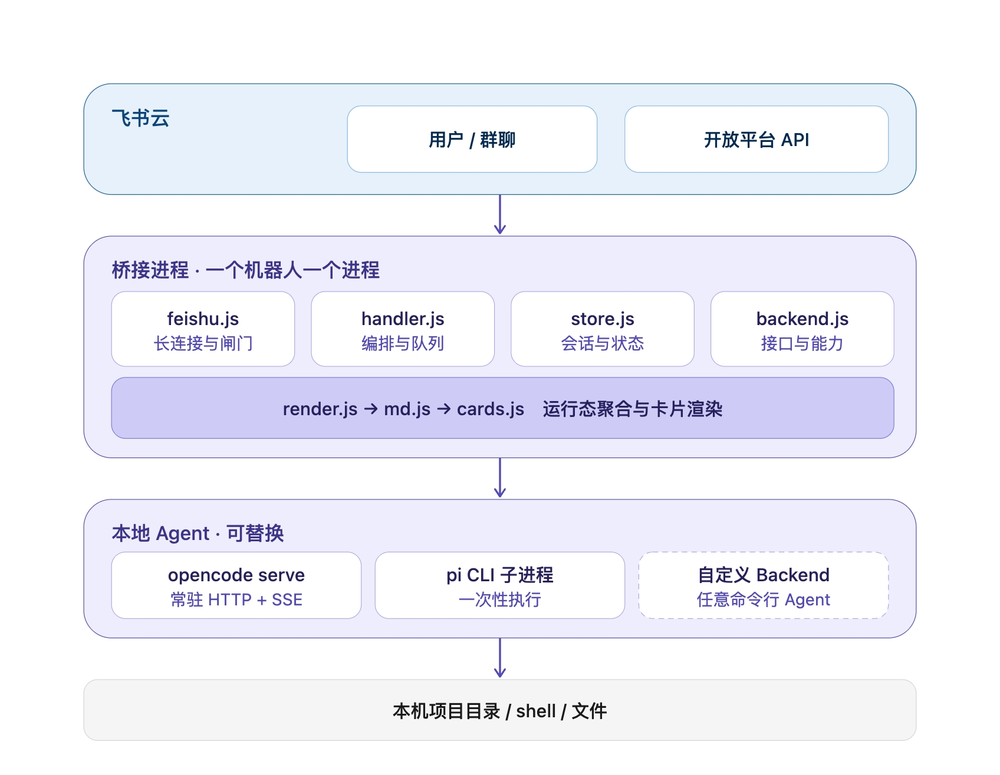
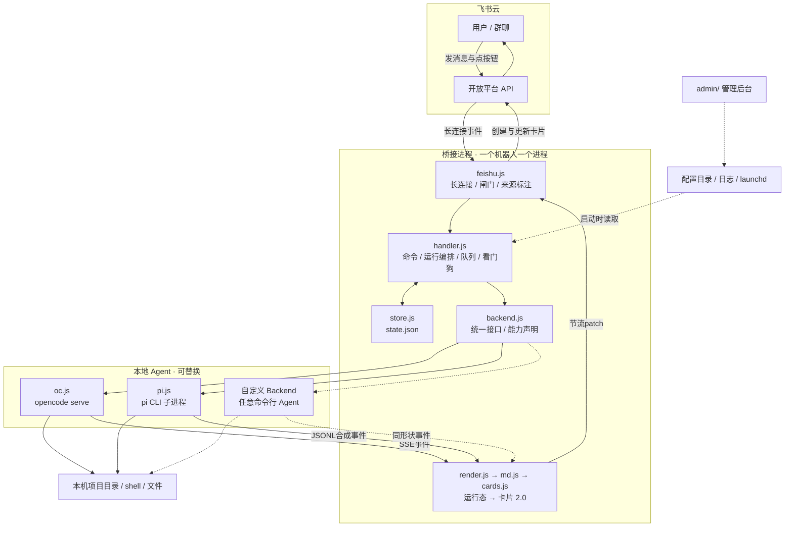
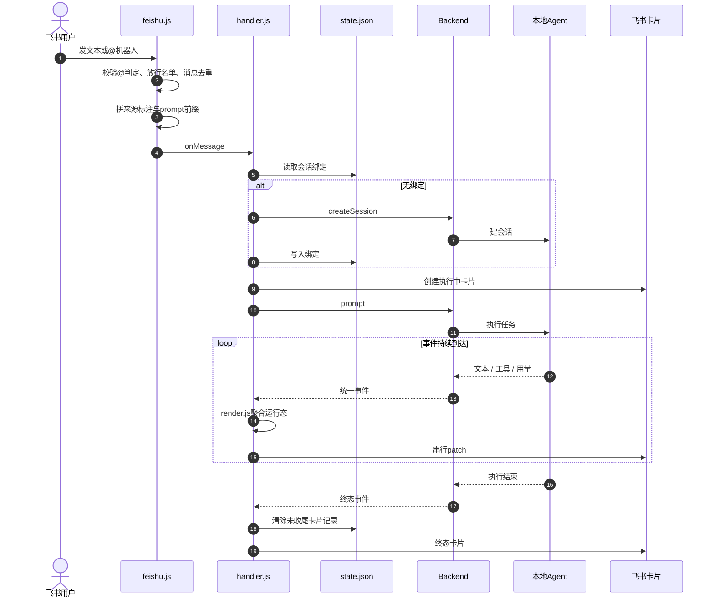
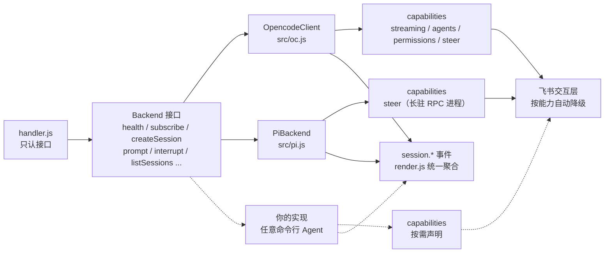
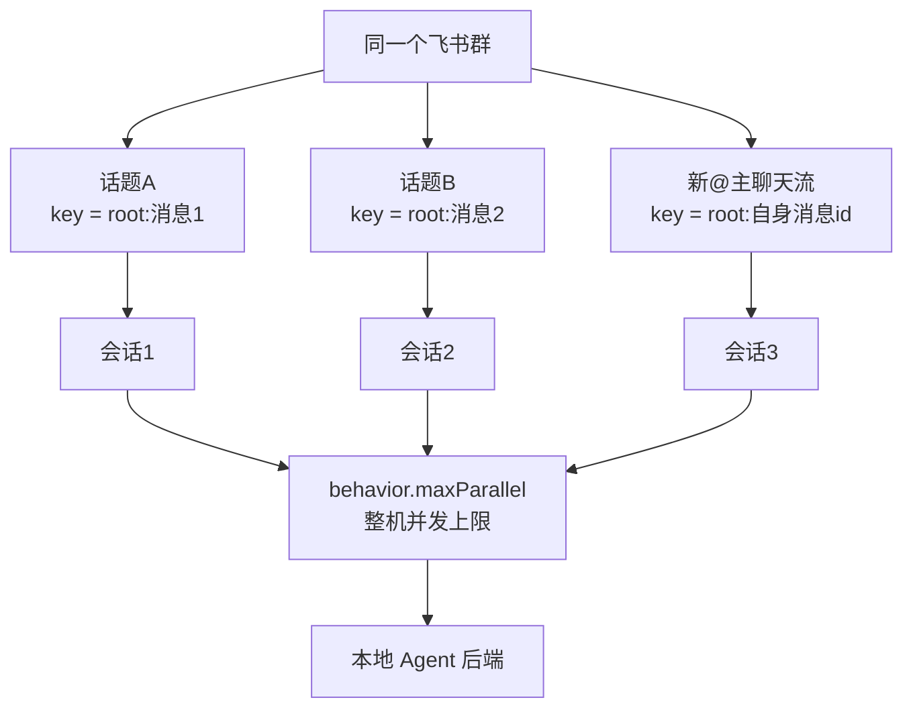

# 飞书 ⇄ 本地 Agent 桥接

把飞书消息变成任务，交给本机 Agent 在指定项目目录执行，再把过程与结果流式推回一张飞书卡片。内置 [opencode](https://opencode.ai) 与 `pi` 两种执行后端；其他命令行 Agent 实现 `Backend` 接口后走同一条链路。事件走飞书长连接，无需公网 IP 与内网穿透。

- 交互层与执行层分离：卡片、命令、会话、排队、中止、僵尸卡收尾由桥接管，具体 Agent 负责执行任务并产生事件。
- 一个进程服务一个机器人。换执行后端只改 `backend.type`。
- 配置与状态放在家目录，仓库内只保留不含密钥的模板 `config.example.json`。
- 运行时依赖只有一个：`@larksuiteoapi/node-sdk`。



产品截图、卡片渲染细节与后台操作见下文各节，设计取舍见 [docs/design-notes.md](docs/design-notes.md)。

---

## 它长什么样

同一套交互的两个切面。

**左**：发一句话 → 卡片流式回结果。中间那张表是**模型输出的 markdown 表格**，被渲染成了飞书原生表格组件（不是文字）。<br>
**右**：`/cd` 换目录后 `/sessions` 出列表，点「切换」换会话，历史回复原封不动。

<table>
<tr>
<td valign="top"><br>
卡片顶部一行元信息：<b>目录</b> / <b>模型</b> / <b>耗时</b> / <b>步数</b>；底部一行用量：<code>in</code> / <code>out</code> / <code>$</code>。工具调用链路默认不显示，只看结论；正文按助手叙述的段累加，每一段之间空一行，多步运行的中间回复和最终答复按顺序都看得见。</td>
<td valign="top"><br>
会话按目录隔离，列表中只出现当前目录下的会话。每条后面有「已用时长 · 模型 · 累计成本」，点「切换」后新发一条确认卡片。</td>
</tr>
</table>

---

## 它能做什么

| 能力 | 行为 |
|---|---|
| 远程派活 | 飞书里发一句话，本机 Agent 在指定项目目录执行 |
| 流式卡片 | 正文、步数、耗时、token、成本在同一张卡片内刷新 |
| 富文本 | Markdown 表格渲染成飞书原生表格，代码块带语法高亮 |
| 多会话 | `/sessions` 列出会话并点按钮切换；`/new` 新建；`/cd` 换目录 |
| 群里并行 | 每 @ 一次开一条话题，一条话题一个会话，多条话题并行执行 |
| 话题近况 | 群里没 @ 我的讨论我本来收不到；被 @ 唤醒时，桥接把该话题最近 N 条消息原文随任务一起带给模型，省掉模型自己去拉聊天记录的那几步（私聊不需要，每条都进会话）。需求与决策见 [docs/topic-context-spec.md](docs/topic-context-spec.md) |
| 结构化上下文 | 发给模型的 body 用 `<profile>` / `<context>` / `<task>` 三段 XML 包起来，段内是键值行：身份与长期规则、本次来源与话题近况、要执行的任务各归其位；`<context>` 里别人的发言和 `<task>` 正文中的同名闭合标签会被中和，不会顶开结构。`behavior.promptLayout=plain` 可一字不差回到旧的方括号前缀。调研与决定见 [docs/context-marking-proposal.md](docs/context-marking-proposal.md)，实测样本见 [docs/prompt-samples.md](docs/prompt-samples.md) |
| 权限审批 | opencode 后端申请读取敏感文件时，飞书弹卡片让人点允许或拒绝 |
| 模型切换 | `/model`、`/agent` 在线切换，无需重启 |
| 排队与中止 | 同一会话上一条还在执行时，人的消息排进队列、bot 之间的 @ 在支持 steer 的后端上直接注入；卡片上可引导（steer）、取消、`/stop` |
| 可换后端 | `opencode` 与 `pi` 内置；其他命令行 Agent 实现 `Backend` 接口后接入，共用卡片、会话、排队与中止逻辑 |
| 多机器人 | 多个飞书应用 + 多份配置 + 多个进程，各自精确判断「@ 的是我」 |

适用场景：人在外面用手机给本机 Agent 派活；多个本机 Agent 在同一个飞书群里分工。

边界：任务在本机执行，不提供云端执行沙箱。桥接进程退出后机器人停止响应，长期运行要装常驻服务。

---

## 工作原理

下面四张图用 Mermaid 绘制，GitHub 与多数 Markdown 预览可直接渲染。每张图后附设计说明。

### 图 1 · 系统架构



整个系统分三层。飞书云负责收发消息与卡片。桥接进程承担全部交互逻辑：消息闸门、命令、会话绑定、队列、卡片刷新、超时收尾。本地 Agent 只负责执行任务并产生事件。把执行层换成另一个命令行工具时，交互层的代码无需改动。

长连接由 `feishu.js` 主动建立，机器人主动连飞书，本机无需公网入口。`admin/` 是旁路，读写配置、查看日志、起停实例，不参与消息链路。

### 图 2 · 一条消息的执行时序



四个关键点：

1. 闸门在飞书层。`@` 判定、放行名单、消息去重在进入 `handler.js` 之前完成。多个机器人同群时，只有被 @ 的那个会往下走。
2. `state.json` 保存会话绑定、排队消息、未收尾卡片。进程重启后，遗留卡片会被标成已中止。
3. 卡片刷新串行执行，间隔由 `behavior.streamIntervalMs` 控制。终态更新最后写入。
4. 同一会话上一条还在执行时，人的新消息排进队列，当前任务结束后自动发送；bot 之间的 @ 在支持 steer 的后端上直接注入当前回合，人的消息也可在卡片上点「引导」注入。

### 图 3 · 后端为什么可以换



`handler.js` 只调用 `Backend` 接口上的方法，`backend.js` 按 `backend.type` 选择实现。两个现有实现的差别被藏在各自文件里：

- `oc.js` 连接常驻的 `opencode serve`，把 SSE 事件流交给 `render.js`。
- `pi.js` 每个会话维持一个长驻 `pi --mode rpc` 进程，消息走 stdin 的 JSONL 命令（`prompt` / `steer` / `abort`），把 RPC 会话事件翻译成 `session.*` 形状的**合成事件**，`render.js` 因此只有一套聚合逻辑。空闲超过 `backend.pi.idleMs` 的进程被回收，下次用同样的 session 参数重启，历史不断。
- `capabilitiesFor()` 声明 `streaming`、`agents`、`permissions`、`steer`、`oneShot`。声明为关闭的能力，`/agent`、权限审批卡片、流式刷新会自动降级。

接入步骤见[开发章节](#开发)。

### 图 4 · 群聊话题与会话绑定



群聊用话题根消息的 id 作绑定键，私聊用 `chat_id`。根消息来自 `root_id`，主聊天流里新 @ 的消息自身成为根，两种情况用同一个公式。多条话题各自绑定独立会话，`behavior.maxParallel` 限制整机同时执行的任务数。同一会话内部仍然串行，新消息排进队列。`state.json` 是绑定的唯一来源，飞书界面里的选中状态不参与判定。

### 模块职责

| 文件 | 职责 |
|---|---|
| `src/index.js` | 入口、单实例锁、`--dry` 终端模式、启动健康检查 |
| `src/config.js` | 配置目录解析、默认值、模板铺开、环境变量覆盖 |
| `src/feishu.js` | 飞书长连接收发、群聊 @ 判定、消息来源标注、话题近况采集、卡片回传 |
| `src/topic-context.js` | 话题近况：群消息缓冲、text/post 拉平、原文渲染与两级截断 |
| `src/prompt-layout.js` | XML 版 body 组装：三段包裹、键值填充、不可信文本的闭合标签中和 |
| `src/template.js` | `{{变量}}` 填充，两套布局共用 |
| `src/errors.js` | 错误分类与「下一步」提示 |
| `src/handler.js` | 命令分发、会话绑定、运行编排、排队、卡片回调、看门狗 |
| `src/backend.js` | 后端工厂与统一能力声明 |
| `src/oc.js` | opencode v2 HTTP API 与 SSE 事件流客户端 |
| `src/pi.js` | pi 子进程、JSONL 事件翻译成合成事件、终端会话接入 |
| `src/render.js` | 事件聚合成运行态（正文、步数、用量） |
| `src/md.js` | Markdown 分段解析成飞书卡片元素 |
| `src/cards.js` | 卡片 2.0 模板 |
| `src/store.js` | `state.json` 读写、遗留字段清理、队列与未收尾卡片持久化 |
| `src/which-opencode.js` | 选择本机 opencode 可执行文件 |
| `src/github-*.js/.mjs` | GitHub App 身份注入与凭证助手 |
| `admin/*.js` | 本地管理后台的服务、实例发现、后端扫描、新建实例 |
| `scripts/*.sh` | 启动、停止、状态、launchd 常驻安装 |

三条设计约束，改代码前先读：

1. `handler.js` 只调用 `backend.js` 暴露的一组方法（`health`、`location`、`subscribe`、`createSession`、`prompt`、`interrupt`、`listSessions` 等）。后端差异留在 `oc.js`、`pi.js` 或新的实现文件内。
2. `state.json` 是会话绑定的唯一数据来源。私聊用 `chat_id` 作键，群聊用 `root:<话题根消息 id>` 作键。同一会话同时只跑一个任务。
3. 同一张卡片的多次刷新串行发出（`flushRun()`）。终态更新与最后一段文本常常同时到达，串行能保证终态最后生效。

---

## 信任边界与身份传递

下面两张图用纯文本绘制，任何 Markdown 预览都能显示。它们描述数据跨越边界时，凭证、身份与权限如何流动。

### 图 5 · 端到端信任边界

```
 [外部 / 飞书云]
 +------------------------------------------------------------------+
 |  用户 A     用户 B     其他机器人                                 |
 |      \        |        /     文本、@、卡片点击                    |
 |       +-------+-------+                                          |
 |                   v                                             |
 |    开放平台   im.message.receive_v1 / card.action.trigger        |
 +------------------------------|-----------------------------------+
                                | 长连接：桥接主动外连，TLS
                                | appId + appSecret -> tenant_access_token
 ================================|==================================== 信任边界
                                v
 [本机 / 桥接进程]   bridge.lock 保证单实例
 +------------------------------------------------------------------+
 | [闸门 1] @ 判定    mentions[].open_id == feishu.botOpenId        |
 | [闸门 2] 放行      allowlist U listen，open_id 按应用隔离         |
 | [闸门 3] 去重      message_id                                    |
 |                            |                                     |
 |   feishu.js --> handler.js --> store.js (state.json)             |
 |        ^             |                                           |
 |        |             v                                           |
 |   发卡片 / patch   backend.js                                    |
 |                        |                                         |
 | [闸门 4] 权限审批   session.permission.* -> 卡片 ->              |
 |                      once / always / reject -> replyPermission   |
 +------------------------|------------------------------------------+
                          | 注入本实例身份（启动时 / 每次任务）
      FEISHU_APP_ID / SECRET / DOMAIN
      LARKSUITE_CLI_CONFIG_DIR -> lark-cli/config.json (600)
      GH_TOKEN / GIT_AUTHOR_* / GIT_COMMITTER_*
      GIT_CONFIG_* -> github-app-credential.mjs
      PATH -> <配置目录>/bin/gh
                          v
 +------------------------------------------------------------------+
 | [本机 / 本地 Agent]    opencode serve   |   pi 子进程            |
 |     读写项目目录、执行 shell、调用模型、提交代码                  |
 +---------------|----------------------------|---------------------+
                 | 以本实例机器人身份发言      | 以 xxx[bot] 推送 / 开 PR
                 v                            v
            飞书（同一应用）               GitHub
```

四个身份域各自独立：

| 域 | 凭证 | 判定位置 |
|---|---|---|
| 人到桥接 | 飞书 `open_id` | `feishu.js` 的 @ 判定、`handler.js` 的 `isAllowed()` |
| 桥接到飞书 | `appId` / `appSecret` / `botOpenId` | `feishu.js` 建立长连接时 |
| 桥接到 Agent | 本实例飞书凭证与 GitHub 身份 | `pi.js` 的 `childEnv()` 或 `scripts/lib/*-identity.sh` |
| Agent 到外部 | `xxx[bot]` 的 token 与提交署名 | `src/github-identity.js` 的四路注入 |

多个机器人同机时，每个实例从自己的 `config.json` 读取凭证并注入自己的子进程，代理发言与代码提交都归属本实例应用。`open_id` 按应用隔离，填写错误时只会静默失效，放行名单变更后要到 `logs/bridge.log` 确认。

### 图 6 · 权限审批回路

```
  本地 Agent          handler.js          飞书卡片          人
      |                   |                  |              |
      | permission.asked  |                  |              |
      |------------------>|  sendCard        |              |
      |                   |----------------->|  允许一次     |
      |                   |                  |  总是允许     |
      |                   |                  |  拒绝         |
      |                   |                  |<--- 点击 -----|
      |                   | card.action.trigger             |
      |                   |<-----------------|              |
      | replyPermission(sessionID, requestID, once|always|reject)
      |<------------------|                  |              |
      |  继续执行 / 拒绝   |                  |              |
```

`session.permission.*` 事件进入 `handler.js` 后立刻推卡片，不走流式聚合。按钮回调携带 `a=perm`、`s`（会话）、`r`（请求）、`d`（决策），`handler.js` 校验 `caps.permissions` 后调用 `replyPermission()`。pi 后端声明 `permissions: false`，这条回路整条关闭。

### 凭证落盘

| 路径 | 内容 | 保护方式 |
|---|---|---|
| `~/.config/opencode-feishu-bridge/config.json` | `appSecret`、serve 密码、GitHub 身份 | 仓库外；`.gitignore` 再拦一道 |
| `state.json` | 会话绑定、排队消息、未收尾卡片 | 仓库外 |
| `bridge.lock` | 单实例锁与进程号 | 仓库外 |
| `lark-cli/config.json` | 只含本实例应用的凭证 | 写入时权限 600 |
| `github-app.pem` | GitHub App 私钥 | 建议权限 600 |
| `logs/*.log` | 运行日志 | `.gitignore` 排除 |

### 管理后台的边界

`admin/` 只监听 `127.0.0.1`。`requestGuards()` 校验 Host 属于 `localhost` 或 `127.0.0.1`，写操作额外要求 `Content-Type: application/json` 与 `X-OCB-Admin: 1`。这套校验用于阻挡跨站表单。响应里的 `appSecret` 与 `opencode.password` 一律掩码；写配置时密钥留空表示保持原值，并先备份成 `config.json.bak`。

### 边界上的薄弱处

| 位置 | 现状 | 后果 |
|---|---|---|
| `feishu.allowlist` 默认空 | 不限制私聊发送者 | 能找到机器人的人都能让它执行本机 shell |
| `botOpenId` 取不到 | 退化成「@ 任何人都响应」 | 多机器人同群会一起抢答 |
| 本地 Agent | 直接读写项目目录与 shell | 缺少沙箱与命令审计 |
| 管理后台 | 只做本地回环与跨站防护 | 本机任意进程都能调用写接口 |
| 凭证 | 明文落在配置目录 | 依赖文件系统权限与磁盘加密保护 |

---

## 环境与依赖

| 项目 | 要求 |
|---|---|
| Node.js | `>= 20`（`package.json` 的 `engines`） |
| 飞书 | 企业自建应用，启用机器人能力，使用长连接接收事件与回调 |
| opencode 后端 | 桌面版 OpenCode.app 自带的 CLI（推荐），或 PATH 里的 `opencode` |
| pi 后端 | 可执行的 `pi` CLI |
| macOS | 可选。launchd 常驻服务依赖 macOS；其他系统用 `npm start` 保持前台运行 |

桌面版自带 CLI 与 App 版本相同，共用同一个会话数据库。混用另一个 npm 全局版本会出现某些会话读不出历史：

```bash
which opencode && npm rm -g @opencode/cli
```

---

## 快速开始

### 1. 安装依赖

```bash
git clone <本仓库地址> && cd opencode-feishu-bridge
npm install
```

### 2. 确认使用哪份 opencode

使用 pi 后端或自定义后端时跳过本节。这类后端不需要 opencode serve。使用 opencode 后端时，`scripts/up.sh` 按以下顺序选择可执行文件：

```
OPENCODE_BIN 环境变量  →  桌面版自带 CLI  →  PATH 里的 opencode
```

```bash
node scripts/which-opencode.mjs --json     # 查看选中的路径、版本、来源
```

`serve` 由 `up.sh` 自动拉起。手工调试时密码要与配置里的 `opencode.password` 一致：

```bash
OPENCODE_SERVER_PASSWORD='my-secret-123' \
  "$(node scripts/which-opencode.mjs)" serve --port 19876 --hostname 127.0.0.1

curl -s -u opencode:my-secret-123 http://127.0.0.1:19876/api/info
```

端口要与 `opencode.url` 一致。

### 3. 创建飞书应用

打开 <https://open.feishu.cn/app> → **创建企业自建应用**。

**3.1 添加机器人能力**：「添加应用能力」→ 机器人 → 启用。

**3.2 添加权限**：「开发配置 → 权限管理」→ 搜索并添加：

| 权限 | 用途 |
|---|---|
| `im:message` | 收发消息、更新卡片 |
| `im:message:send_as_bot` | 以应用身份发消息 |
| `im:message.p2p_msg:readonly` | 读取私聊消息 |
| `im:message.group_at_msg:readonly` | 读取群里 @ 机器人的消息 |
| `im:chat:readonly` | 可选，读取群名称 |
| `im:chat.members:read` | 可选，读取群成员名字 |

**3.3 订阅事件**：「事件与回调 → 事件配置」→ 订阅方式选 **使用长连接接收事件** → 添加 `im.message.receive_v1`。

**3.4 订阅卡片回调**：同一页面切到「回调配置」→ 订阅方式选 **使用长连接接收回调** → 添加 `card.action.trigger`。部分控制台把这一项放在「事件配置」里，名称叫「卡片回传交互」。漏掉这一步，卡片按钮会一直转圈。

**3.5 发布版本**：「版本管理与发布」→ 创建版本 → 申请发布。企业自建应用通常需要管理员审批；权限变更后必须重新发版。

**3.6 复制凭证**：「凭证与基础信息」→ App ID（`cli_` 开头）与 App Secret。

### 4. 初始化配置

配置目录按以下顺序解析，第一个命中的生效：

| 优先级 | 位置 |
|---|---|
| 1 | `$OCB_CONFIG_DIR` |
| 2 | `~/.config/opencode-feishu-bridge/` |

`npm start`、`scripts/*.sh`、`scripts/probe-*.mjs` 共用这套解析规则。配置放在仓库外，`appSecret` 不进入工作树。

```bash
npm run init                                        # 交互向导
npm run init -- --app-id=cli_xx --app-secret=yy     # 传入凭证，只问剩余项
npm run init -- --no-input                          # 只铺模板，适合 CI
npm run init -- --force                             # 覆盖现有配置，先备份成 .bak
npm run init -- --add-allow=ou_你的openid           # 往现有配置追加白名单
```

向导会验证凭证、自动填入 `feishu.botOpenId`、写入你的 `open_id` 白名单。配置已存在时默认不覆盖。

配置目录内的文件全部由本机生成：

| 文件 | 生成者 | 内容 |
|---|---|---|
| `config.json` | `npm run init` 或首次 `npm start` | 配置，含 `appSecret` |
| `state.json` | 桥接 | 会话绑定、排队消息、未收尾卡片 |
| `bridge.lock` | 桥接 | 单实例锁，写入进程号 |
| `pi-sessions/` | pi 后端 | 会话索引与 JSONL 记录 |

最小可用配置（模板全文见 `config.example.json`）：

```json
{
  "feishu": {
    "appId": "cli_a1b2c3d4e5f6g7h8",
    "appSecret": "你的 App Secret",
    "domain": "feishu",
    "allowlist": ["ou_你的open_id"],
    "requireMention": true,
    "botOpenId": "ou_机器人自己的open_id"
  },
  "opencode": {
    "url": "http://127.0.0.1:19876",
    "password": "my-secret-123",
    "defaultDirectory": "/Users/you/project",
    "defaultModel": "stepfun-step-plan/step-3.5-flash"
  }
}
```

两项要点：

- `opencode.defaultModel` 填 `providerID/modelID`。opencode 默认模型在部分地区会报 `RegionError`。列出可用模型：

  ```bash
  curl -s -u opencode:my-secret-123 http://127.0.0.1:19876/api/model \
    | python3 -c "import sys,json;[print(f\"{m['providerID']}/{m['id']}\") for m in json.load(sys.stdin)['data']]"
  ```

- `feishu.allowlist` 空数组表示任何人私聊机器人都能操作本机文件与 shell。先留空启动一次，给机器人发消息后从日志取得自己的 `open_id`，再执行 `npm run init -- --add-allow=ou_你的openid`。

### 5. 体检

```bash
npm run doctor
```

检查 Node 版本、`config.json` 完整性、凭证格式、白名单、opencode 可执行文件版本一致性、serve 连通性、模型与 agent 列表、`defaultModel` 是否在列表内、默认目录是否存在、状态文件概要。存在失败项时退出码为 1。

### 6. 启动

推荐装成 launchd 常驻服务：登录自启、进程退出后自动拉起、不依赖终端。

```bash
./scripts/install-agent.sh     # 安装一次
./scripts/status.sh            # 状态、运行时长、最近日志
./scripts/up.sh                # 重启（launchd 模式下执行 kickstart）
./scripts/down.sh              # 暂停（下次 up.sh 或下次登录会启动）
./scripts/uninstall-agent.sh   # 卸载
```

不装服务也能用，`up.sh` 会以 `nohup` 方式同时拉起 `serve` 与桥接：

```bash
npm run up        # 等同于 ./scripts/up.sh
npm run down      # 等同于 ./scripts/down.sh
npm start         # 前台运行，日志打到 stdout，适合调试
```

`up.sh` 会读取配置里的 `opencode.password`，用同一密码启动 serve。看到 `✅ 桥接已就绪` 后，在飞书里私聊机器人发 `/help`。

注意：

- 桥接有单实例锁（`bridge.lock`）。第二个进程会直接退出，避免同一条消息被回两遍。
- 桌面版 OpenCode App 无需常开。桥接用的是 App 安装在磁盘上的 CLI。升级桌面版后执行 `./scripts/down.sh && ./scripts/up.sh`，让 serve 换到新版本 CLI。
- `nohup` 起的进程挂在某个 shell 的进程组里，该 shell 退出时可能一起被收掉。长期运行用 `install-agent.sh`。

### 7. 无飞书验证

```bash
npm run dry
```

终端 REPL，把飞书换成 stdin，卡片渲染成 ASCII 框。会话创建、流式事件、命令分发与真机一致。输入 `/help` 看命令，`/quit` 退出。

---

## 配置

`config.example.json` 是配置模板，`prompts.json` 保存发给模型的全部文案（按 `always` / `once` 分组，互斥选项收在字典里），`src/config.js` 的 `DEFAULTS` 提供其余缺省值。文件配置覆盖默认值，环境变量覆盖文件配置。配置在进程启动时读取，修改后重启实例生效。

### 字段

| 键 | 说明 | 默认值 |
|---|---|---|
| `backend.type` | `opencode` 或 `pi` | `opencode` |
| `backend.pi.bin` | pi CLI 路径 | `pi` |
| `backend.pi.model` | 传给 `--model`，留空用 pi 的默认值 | `""` |
| `backend.pi.timeoutMs` | 模型静默多久判定超时（无在飞工具时），每吐一行 stdout 重置 | `600000` |
| `backend.pi.toolTimeoutMs` | 工具在飞时的静默预算，`tool_execution_start` 切换、`end`/`turn_end` 切回 | `1800000` |
| `backend.pi.settleQuietMs` | 最终回答后静默多久按已完成收尾，`0` 关闭此机制 | `180000` |
| `backend.pi.extraArgs` | 额外启动参数，例如 `["--no-extensions"]` | `[]` |
| `backend.pi.cliSessionRoot` | 终端 `pi -r` 会话根目录 | `~/.pi/agent/sessions` |
| `feishu.appId` / `feishu.appSecret` | 应用凭证 | `""` |
| `feishu.domain` | `feishu` 或 `lark` | `feishu` |
| `feishu.allowlist` | 放行名单，空数组表示不限制 | `[]` |
| `feishu.listen` | 单向放行名单。A 的 `listen` 含 B 时，B 的 @ 能唤醒 A | `[]` |
| `feishu.requireMention` | 群里是否必须 @ 本机器人才响应 | `true` |
| `feishu.botOpenId` | 机器人自身 open_id。留空则启动时向飞书查询 | `""` |
| `feishu.names` | `open_id → 显示名`，用于来源标注显示名字，并渲染成前缀里的「可@的 id」一行 | `{}` |
| `opencode.url` | serve 地址 | `http://127.0.0.1:19876` |
| `opencode.password` | serve 密码，与 `OPENCODE_SERVER_PASSWORD` 一致 | `""` |
| `opencode.defaultDirectory` | `/new` 不带目录时使用；pi 每次执行也起在该目录 | `$HOME` |
| `opencode.defaultModel` | `providerID/modelID`，建议显式填写 | `""` |
| `github.mode` | `off` / `app` / `pat`，控制 GitHub 身份注入 | `off` |
| `github.appId` / `installationId` / `privateKeyPath` | GitHub App 身份参数 | `""` |
| `github.token` | `pat` 模式使用的个人访问令牌 | `""` |
| `github.gitName` / `github.gitEmail` | 提交署名 | `""` |
| `behavior.streamIntervalMs` | 卡片刷新间隔，低于 1200 会被飞书限流 | `1800` |
| `behavior.showReasoning` | 是否在卡片展示思考过程 | `false` |
| `behavior.showTools` | 是否展示工具调用链路 | `false` |
| `behavior.maxBodyChars` | 卡片正文字符上限，超出保留尾部 | `6000` |
| `behavior.idleTimeoutMs` | 仅 opencode 后端：没有工具在飞时，多久没有事件就判定卡死并收尾，`0` 关闭 | `300000` |
| `behavior.toolIdleTimeoutMs` | 仅 opencode 后端：有工具在飞时的静默阈值。母回合派生子代理或跑长 bash 期间自己一条事件都不发，静默是预期行为，按模型档判定会误杀；真挂死的工具到这一档仍兜底 | `1800000` |
| `behavior.maxParallel` | 整机同时运行的任务数，`0` 表示不限 | `2` |
| `behavior.topicContext` | 群消息被唤醒时是否带上该话题最近 N 条消息原文（私聊不受影响） | `true` |
| `behavior.topicContextMessages` | 近况最多带几条，`@` 过我的轮次只算一行指针 | `20` |
| `behavior.topicContextChars` | 近况总字数上限，超出保尾（最近的优先） | `2500` |
| `behavior.promptLayout` | 发给模型的 body 结构：`xml` = 三段 XML 键值，`plain` = 旧的方括号线性前缀 | `xml` |
| `prompt.templates` | 按同路径深合并覆盖 `prompts.json` 里的提示词模板，只写一个键不影响同组其余选项 | `{}` |
| `prompt.prefixes` | 发给模型的文本前缀数组，条目含 `id`、`mode`（`once` / `always`）、`text` | `[{ "id": "rules", "mode": "once", "text": "" }]` |

### 提示词模板

发给模型的全部文案放在仓库根的 `prompts.json`。代码只做 `{{变量}}` 替换，不保存提示词。打开该文件即可审阅与编辑，改动作用于所有未覆盖该键的实例。模板在进程启动时读取，编辑后重启实例生效。

文件里有两套互不干扰的文案：

- **`layout.xml`（默认）**：`profile` / `context` / `task` 三个数组**逐行写死了整份提示词**——从上到下读一遍就是模型收到的完整 XML，标签、键值标题、契约说明、行序都在里面，只有 `{{变量}}` 由实例数据替换。`variants` 是按后端、群聊/私聊、话题内/主聊天流选的几组「值模板」，只是填进变量的值，不是结构。某行引用的任一变量为空时整行/整块自动消失，所以私聊不会留下空的「你的同伴」键、没近况时不会出现空的「话题近况」键，文件里也不需要写条件语法。代码（`src/prompt-layout.js`）只填变量、选段（首条才带 profile）、中和不可信值，**不拼标签、不决定行序**。
- **`always` + `once`**：给 `behavior.promptLayout=plain` 的旧方括号前缀用。

`once.rules` 是两版共用的行为准则，措辞保持布局无关。改提示词基本只需要改 `layout.xml` 里的那几行；改完用 `npm run probe:prompt` 看真正发出的 body。

文件里只剩模板数据，没有任何说明性字段。`layout.xml` 是默认的完整 XML 提示词；`always` / `once` 是 `behavior.promptLayout=plain` 回退时用的互斥选项组，打开就能看出「这组里选一个」：

```
prompts.json
├── layout.xml          默认：逐行写死的完整提示词
│   ├── profile         { 6 行 }  会话第一条才带
│   ├── context         { 7 行 }  每条都带
│   ├── task            { 3 行 }  每条都带
│   └── variants        identity / source / ids 的值模板，按后端与场景各选一句
├── always              plain 模式：每次 @ 本机器人都发
│   ├── origin          { group | private }                    互斥：群 / 私聊
│   ├── where           { groupNamed | groupFallback | private } 互斥：群名 / 私聊
│   ├── scope           { thread | main }                      互斥：话题 / 主聊天流
│   ├── ids             { thread | main | private }              互斥：协作要用的 id 一行
│   ├── peers           { list | empty }                         互斥：可@的同伴 id
│   ├── sender          { named | idOnly | unknown }           互斥：发送者信息完整度
│   ├── senderType      { user | bot }                         互斥：人 / 机器人
│   ├── identityLine    { pi | opencode }                      互斥：后端类型
│   ├── identityApp     飞书应用片段（标量，不是互斥组）
│   └── topicContext    话题近况头（标量，群里被 @ 唤醒时拼上）
└── once                plain 模式：只在群会话第一条消息发一次
    └── rules           协作与溯源规则（整段文本，xml 模式也经 {{rules}} 复用）
```

`plain` 模式下，`always` 下各项是**并行拼接**的：一条消息的前缀依次放入来源标注、协作 id、身份声明、可@的同伴、配置里的 always 前缀。只有字典**内部**的键才是「选其中之一」，选谁由代码按运行时条件决定。来源标注里的 `where`、`scope`、`sender`、`senderType`、`when` 是同时填入的变量，不互斥。

| 频率 | 模板键 | 互斥选项 | 选择条件 | 变量 |
|---|---|---|---|---|
| always | `always.origin` | `group` / `private` | 群消息 / 私聊 | `where` `scope` `sender` `senderType` `when` |
| always | `always.where` | `groupNamed` / `groupFallback` / `private` | 群名取到 / 取不到 / 私聊 | `name` |
| always | `always.scope` | `thread` / `main` | 话题内 / 主聊天流；私聊时整段为空 | 无 |
| always | `always.ids` | `thread` / `main` / `private` | 话题内 / 主聊天流 / 私聊 | `chat` `thread` `root` `msg` `self` |
| always | `always.peers` | `list` / `empty` | `feishu.names` 有声明 / 一条也没有 | `peers` |
| always | `always.sender` | `named` / `idOnly` / `unknown` | 名字+id / 只有 id / 都拿不到 | `name` `id` |
| always | `always.senderType` | `user` / `bot` | 人类 / 机器人 | 无 |
| always | `always.identityLine` | `pi` / `opencode` | 后端类型 | `who` `app` |
| always | `always.identityApp` | 无（标量） | 配了 `appId` 才拼 | `appId` |
| once | `once.rules` | 无（整段文本） | 只在群里、且是会话第一条消息 | 无 |

`always.ids` 装的是**协作要用的全部 id**：`chat` 用于 `msg send --receive-id` @ 唤醒别人，`thread` 用于 `msg thread-messages` 拉话题历史，`root` 用于 `msg reply` 回到话题里发言，`msg` 用于精确回复本条，`self` 是自己的 open_id（@ 判定与自我介绍都要用）。这些 id 事件里全都有，早期只传了 `thread`，agent 每次协作都得先去 `logs/bridge.log` 里翻剩下的。在不在话题里看 `thread_id`：飞书对任何回复都返回 `root_id`，主聊天流里一句普通引用回复也带 `root_id`，只有真话题消息才带 `thread_id`。`always.peers` 渲染 `feishu.names` 里声明的同伴，open_id 按应用隔离，这里给的必须是本应用视角的值；只在群里拼。

| 组 | 何时发 | 装什么 |
|---|---|---|
| `always` | 每一次 @ 本机器人。私聊每条、群里每条命中 @ 的消息都带 | 本条消息的动态信息：来源标注、协作 id、身份声明、可@的同伴，加上 `prompt.prefixes` 里所有 `mode: "always"` 的自定义前缀 |
| `once` | 该会话第一条消息，只一次；`src/handler.js` 判定走了 `createAndBind()` 的那次。续聊不拼，私聊也不拼 | 静态规则 `once.rules`。拼过之后留在会话历史里，每轮重复只是白烧 token |

`once.rules` 的开关在配置的 `prompt.prefixes`：`id: "rules"` 的条目存在且 `mode: "once"` 才发；把 `mode` 改成 `always` 就变成每条都发（会话被压缩、规则滚出上下文时可这样兜底），删掉条目则关闭。

单个实例要改某条文案时，在该实例 `config.json` 的 `prompt.templates` 里写**同样的嵌套路径**。合并是深合并，只改一个选项不会冲掉同组其余选项：

```json
"prompt": {
  "templates": {
    "always": {
      "senderType": { "bot": "另一个 Agent" },
      "identityLine": { "pi": "[身份 · 你是 {{who}}，凭证已注入]" }
    },
    "once": {
      "rules": "[协作 · 你的规则文本]"
    }
  },
  "prefixes": [
    { "id": "rules", "mode": "once", "text": "" }
  ]
}
```

`prefixes` 里 `id: "rules"` 的 `text` 填写后会覆盖 `templates.once.rules`，但只对该实例生效；`text` 留空就是用模板文件里的版本。

### 环境变量

| 变量 | 作用 |
|---|---|
| `OCB_CONFIG_DIR` | 指定配置目录，多实例必需 |
| `OCB_INSTANCE` | launchd 服务名后缀，多实例必需 |
| `OCB_BACKEND` / `OCB_PI_BIN` / `OCB_PI_MODEL` | 覆盖后端类型、pi 路径、pi 模型 |
| `FEISHU_APP_ID` / `FEISHU_APP_SECRET` / `FEISHU_DOMAIN` | 覆盖飞书凭证与域名 |
| `OPENCODE_URL` / `OPENCODE_SERVER_PASSWORD` | 覆盖 serve 地址与密码 |
| `OPENCODE_BIN` | 指定 `up.sh` 使用的 opencode 可执行文件 |
| `BRIDGE_DEFAULT_DIR` / `BRIDGE_DEFAULT_MODEL` | 覆盖默认目录与默认模型 |
| `BRIDGE_ALLOWLIST` | 逗号分隔的白名单 |
| `BRIDGE_NODE` | `install-agent.sh` 写入 plist 的 node 路径 |
| `OCB_SDK_TIMEOUT_MS` | 飞书 SDK 请求超时，默认 20000 |
| `PORT` | 管理后台监听端口，默认 19877 |

### 密钥

`config.json` 含 `appSecret`，`state.json` 含本机会话绑定，两者都在仓库外。`.gitignore` 排除 `.config/` 作为第二道防线。不要执行 `git add -f` 把它们加入仓库。管理后台保存配置时，密钥字段留空表示保持原值，并自动备份成 `config.json.bak`。

---

## 飞书里怎么用

一条请求对应一条消息。发文本会新开一张卡片承载本次执行，流式刷新发生在这张卡片内部。点「会话列表」「切换」「新会话」「授权」会新发一条卡片，历史回复保持原样。列表翻页只更新列表卡片自己。

### 命令

| 命令 | 作用 |
|---|---|
| 直接发文本 | 发给当前绑定会话，没有绑定时自动创建 |
| `/help` | 命令列表 |
| `/new [目录]` | 新建会话并绑定。默认名 `飞书·YYYYMMDD·新建会话n`，n 按天从 1 开始只增不减（删会话、重命名都不回收序号） |
| `/sessions` | 会话列表卡片，点按钮切换 |
| `/switch <序号\|id>` | 文本方式切换会话 |
| `/rename <标题>` | 重命名当前会话 |
| `/del <序号>` | 删除会话 |
| `/cd <目录>` | 换工作目录并重置绑定 |
| `/stop` | 中止当前执行 |
| `/status` | 查看绑定、模型、token、成本 |
| `/model` / `/model <序号>` | 列出模型 / 切换模型 |
| `/agent` / `/agent <名字>` | 列出 agent / 切换 agent（仅 opencode 后端） |

别名：`/ls` = `/sessions`，`/use` = `/switch`，`/abort` = `/stop`，`/delete` = `/del`，`/?` = `/help`。

### 群聊规则

- 群里每 @ 一次开一条话题，并为这条话题建立独立会话。多条话题可以并行，整机上限由 `behavior.maxParallel` 控制。
- 话题内继续说话仍需 @ 本机器人，消息会接在同一条话题的会话上。
- @ 判定按 `open_id` 精确比对。`feishu.botOpenId` 显式填写后，多机器人同群时只响应 @ 自己的消息；取不到自身 open_id 时会退化成「@ 任何人都会响应」，启动日志会给出告警。
- 没有 @ 的消息不触发执行（不建 run、不进会话），但它的原文会进「话题近况」缓冲，供下一次被 @ 唤醒时带给模型。被 @ 的是别人时，日志记一行 `[skip]`，带被 @ 者的名字。
- 话题近况：被 @ 唤醒时，把该话题最近 N 条原文（含没 @ 我的轮次、其他 agent 的发言）随任务一起发给模型——text 与 post 富文本按文字拉平，图片/文件/卡片给一行占位符；已 @ 过我的轮次只给指针行（正文已在会话历史里，不重复计费）。话题内按 `root:<话题根>` 聚，主聊天流按 `chat:<群>` 聚，两者互不串扰；自己的卡片不进缓冲；私聊不采集（每条消息本来就进会话）。限额见 `behavior.topicContext*`，总字数超了保尾。缓冲只在内存里，重启后更早的历史仍可用 `feishu-cli` 拉。
- 占位符处理：@ 本机器人的占位符被删掉，@ 别人的占位符还原成 `@姓名`，模型能看见这句话在跟谁说。
- 每条消息前拼前缀，依次是来源标注（群名或私聊、主聊天流或话题内、发送者完整 `open_id`、人还是机器人、时间）、协作 id 一行（`chat` / `thread` / `root` / `msg` / `self`）、身份声明、可@的同伴 id。名字来自 `feishu.names` 或群成员接口（`im:chat.members:read`）；两者都没有时只显示 `open_id`。

放行闸门取 `feishu.allowlist` 与 `feishu.listen` 的并集，由人在配置或管理后台维护。`open_id` 按应用隔离，填写错误时只会静默失效，加完去看 `logs/bridge.log` 是否出现「拒绝非白名单用户」。

### 排队

同一会话同时只跑一个任务。上一条还在执行时，人的新消息默认排进 follow-up 队列，当前任务结束后自动发送，卡片会显示排在第几位。「取消」把它从队列移除。

bot 之间的 @ 不排队：支持 steer 的后端上直接注入正在跑的那一轮（opencode 走 `delivery=steer`，pi 走 RPC 的 `steer` 命令），下一个步骤边界生效、不中止，群里回一条「已引导」；注入失败才退回排队，消息不丢。两个桥接 bot 之间因此是实时协调，人等结果的习惯不变。

「引导」是改主意的选项，按后端能力分两种：

- **支持 steer 的后端**（opencode 与 pi）：引导 = 把消息注入正在跑的那一轮，下一个步骤边界交给 agent，当前工作不中止、已处理的痕迹不清除——与 Claude Code 的 Enter、Codex 的 Enter 一致。opencode 走 serve 的 `delivery=steer`；pi 走长驻 RPC 进程的 `steer` 命令（2026-11-13 起，见 `docs/pi-backend.md` 第 13 节）。引导后消息出队，卡片翻新成「已引导」。

引导时若任务已经结束（点得太慢），或注入失败（老版本 serve 不认识 `delivery`），退回老行为：消息放回队首，中止当前任务后发出，消息不丢。

队列落在 `state.json` 里，桥接重启后保留。

### 卡片渲染

| Markdown | 飞书组件 |
|---|---|
| 表格 | 原生表格，表头灰底，超过 10 行飞书内部分页 |
| 围栏代码块 | 带语法高亮的 `markdown` 组件 |
| `## 标题` | 加粗正文 |
| `- 列表` / `> 引用` | 圆点列表 / 普通正文 |
| 加粗、斜体、行内代码、链接 | 原样支持 |

单张卡片上限 30KB，超大表格裁剪到 50 行 8 列。卡片分三段：前缀（目录 / 模型 / 耗时 / 步数）、正文、后缀（用量小字与按钮）。正文按助手叙述的段累加，段间空一行。金额保留两位小数；部分模型提供商在 `/api/model` 里把成本填 0，此时显示 `$0.00`。

---

## 执行后端与多实例

### 能力矩阵

| 能力 | opencode 后端 | pi 后端 |
|---|---|---|
| 执行方式 | 常驻 `opencode serve`，HTTP + SSE | 每个会话一个长驻 `pi --mode rpc` 进程，stdin/stdout 走 JSONL |
| 流式正文 | 原生事件流 | 把 RPC 会话事件翻译成同形状的合成事件 |
| 引导（steer，忙时注入当前回合） | 支持（serve 的 `delivery=steer`） | 支持（RPC 的 `steer` 命令，2026-11-13 起） |
| 卡片、节流、中止、僵尸卡收尾 | 共用 | 共用 |
| 权限审批卡片 | 支持 | 不支持 |
| `/agent` | 支持 | 不支持 |
| 会话 | 由 serve 管理，接口查询 | `<配置目录>/pi-sessions/` 的索引与 JSONL；兼容终端 `pi -r` 会话 |
| 卡死判定 | `behavior.idleTimeoutMs`（无工具在飞）、`behavior.toolIdleTimeoutMs`（工具在飞） | `backend.pi.timeoutMs`（模型静默）、`backend.pi.toolTimeoutMs`（工具在飞）与 `backend.pi.settleQuietMs` |

pi 的 `/sessions` 同时列出桥接会话与终端 `pi -r` 会话。切到终端会话后走 `pi --session <文件>` 续聊，两端读写同一个 JSONL。终端会话的改名、删除、切模型由 pi 自己管理，桥接会明确拒绝这三个操作。

### 多实例

一个机器人 = 一个飞书应用 + 一份配置 + 一个进程。第二个实例用 `pi` 后端时：

```bash
mkdir -p "$HOME/.config/opencode-feishu-bridge-pi"
OCB_CONFIG_DIR="$HOME/.config/opencode-feishu-bridge-pi" npm run init
# 编辑该目录的 config.json：backend.type = pi，填入新应用的凭证
./scripts/install-agent.sh --instance pi --config-dir "$HOME/.config/opencode-feishu-bridge-pi"
OCB_INSTANCE=pi npm run status
OCB_INSTANCE=pi npm run up
```

`OCB_CONFIG_DIR` 决定读哪份配置，`OCB_INSTANCE` 决定 launchd 服务名。后续重启、查看状态都要带同一个 `OCB_INSTANCE`。`install-agent.sh` 会按 `backend.type` 决定是否安装 serve 服务。管理后台的「新建实例」弹窗可以代替上述命令。

### 身份注入

飞书身份与 GitHub 身份各有一层注入，保证多个 agent 同机时发言、提交都用自己的应用：

- pi 后端：起子进程前由 `src/pi.js` 的 `childEnv()` 注入。
- opencode 后端：代理跑在常驻 serve 里，注入点放在 serve 启动处（`scripts/agent/serve.sh` 与 `scripts/up.sh`）。
- 注入内容：`FEISHU_APP_ID` / `FEISHU_APP_SECRET` / `FEISHU_DOMAIN`、本实例的 `lark-cli` 配置目录、GitHub 的 `GH_TOKEN` 与提交署名与 git 凭证助手与 `gh` 包装脚本。
- 配置里没有凭证时不注入，沿用机器级配置。身份在进程启动时读取，改配置后重启 serve（opencode）或等下一次任务（pi）即跟随。

`github` 段的完整字段、App 创建步骤、token 刷新机制与排障命令见 [docs/pi-backend.md 第 6.1 节](docs/pi-backend.md#61-github-身份github-段)。`prompt.prefixes` 的 `once` / `always` 语义与拼装顺序见[第 6.2 节](docs/pi-backend.md#62-prompt-前缀prompt-段)。

已知风险：机器人之间互相 @ 没有轮次护栏。多个 agent 同群协作时，机器人可能连续聊好几轮，目前靠模型自己判断停止。

---

## 本地管理后台

零新增依赖的浏览器界面，用 node 内置模块起服务，界面是单页原生 HTML/JS，没有构建步骤。

```bash
npm run admin                # 监听 127.0.0.1:19877
npm run admin -- --port 8080 # 换端口
```

打开 <http://127.0.0.1:19877>。

| 页面 | 功能 |
|---|---|
| 总览 | 实例状态、后端类型、配置目录、pid 与运行时长、serve 版本、会话数与进行中卡片数；已装 launchd 服务时可启动、停止、重启 |
| 配置 | 按实例编辑 `config.json`；后端选项来自本机扫描；密钥掩码显示，留空保持原值 |
| 飞书应用 | 校验凭证、管理 `allowlist` / `listen` / `names` |
| 会话与后端 | serve 健康、模型列表、会话列表；飞书绑定可查看与解除绑定，后端会话可查看与删除；`state.json` 概要、pi CLI 版本 |
| 日志与体检 | `bridge.log` / `serve.log` 增量跟随；按实例运行 `doctor` |
| 新建实例 | 三步生成配置、自动分配 serve 端口与密码、安装 launchd 服务并启动；失败自动回滚 |

接口以 `/api/instances` 与 `/api/backends` 为入口，子路径包含 `config`、`allowlist`、`names`、`listen`、`action`、`logs`、`doctor`、`feishu-verify`、`sessions`、`models`、`reveal`，删除用 `DELETE /api/instances/:name/bindings/:key` 与 `DELETE /api/instances/:name/sessions/:sid`。

安全边界：只监听 `127.0.0.1`；Host 头只接受 `localhost` 与 `127.0.0.1`；接口只收 `application/json`；写操作（POST / PUT / PATCH / DELETE）额外要求 `X-OCB-Admin: 1`；密钥不回传浏览器、不写入后台日志；起停操作只对已装 launchd 服务的实例开放。

代码在 `admin/`：`server.js`（服务与接口）、`instances.js`（实例发现）、`backends.js`（本机扫描）、`create.js`（新建实例）、`control.js`（起停、体检、日志）、`entries.js`（名单操作）、`public/index.html`（界面）。

### 第 1 步：看总览

启动后落在「总览」页，实例表格一行一个实例，各列含义：

- **状态**：运行中（绿点）、launchd 已装未跑（黄点）、未运行（灰点）；有任务在执行时，状态后跟蓝色「N 张进行中」徽章。
- **pid / 时长**：桥接进程号与已运行时长。
- **serve**：opencode 后端的 serve 版本；pi 后端显示 pi CLI 的版本号，CLI 跑不起来时显示异常。
- **会话 / 进行中**：绑定会话数与正在执行的卡片数。
- **操作**：运行中的实例显示重启、停止；未运行的实例显示启动。只对已装 launchd 常驻服务的实例显示；没装的实例在这一列给安装指引。配置目录与飞书应用两列超长时省略显示，悬停看完整内容。


### 第 2 步：改配置

点左侧「配置」，在页面左上角选实例。表单按配置顺序分两列加一段：

- **coding agent**（左列）：后端选择框的选项来自打开页面时对本机的自动扫描——opencode 与 pi 各带「本机版本」或「未安装」标记，下方一行说明复用的本地可执行文件、版本与来源（桌面版自带 CLI、PATH、常见用户 bin 目录）。选哪个后端显示哪组字段：opencode 显示 serve 地址与 serve 密码；pi 显示 pi.bin、pi.model、pi.timeoutMs、pi.toolTimeoutMs、pi.extraArgs，pi.bin 预填扫描到的本机路径。默认工作目录与默认模型两个后端共用，留空即用 coding agent 自己的本地默认值（pi 每次执行起在默认工作目录里，opencode 的 `/new` 不带目录时也用这个）。
- **飞书应用**（右列）：appId、appSecret、domain、botOpenId，以及群聊是否必须 @ 本机器人才响应。
- **behavior**：卡片刷新间隔、正文上限、空闲超时、并发上限，思考过程与工具链路是否展示。

两个密钥字段（appSecret 与 serve 密码）只显示「已填写」，输入框留空表示保持原值，不会把密钥冲掉。保存前自动备份成 `config.json.bak`，用临时文件加重命名落盘。配置在进程启动时读取，改完必须重启实例才生效。


### 第 3 步：管飞书应用

点左侧「飞书应用」：

- 点「校验凭证」，后台打一次 `bot/v3/info`：通过则显示机器人名与 open_id，失败给出具体原因。
- 白名单逐条管理：填 open_id 点「加入白名单」，不要的点「移除」。空数组等于任何人私聊机器人都能操作本机，建议填上自己的 open_id。加入时名字选填，写进 `feishu.names`；已有条目的名字在行内改，点「保存名字」生效，清空保存即删除声明。
- 名字对照来自配置里的 `feishu.names`：飞书没有 open_id 反查名字的接口，在这里声明后，消息来源标注里直接显示名字。这一节可以逐条增、改、删；白名单行的名字列显示生效名字（配置声明的优先，其次是有 @ 提当时自动攒到的）。


### 第 4 步：看会话与后端

点左侧「会话与后端」：上半是后端健康（serve 版本与 pid、serve 地址、默认工作目录）与状态文件概要（绑定会话数、进行中卡片、攒到的名字）；往下是进行中的卡片、飞书绑定、后端会话三张表，以及模型列表。两个后端都有会话，存放方式不同：opencode 的问常驻 serve；pi 的没有 serve，桥接把会话索引写在配置目录的 `pi-sessions/index.json`，详细记录是同目录下的 JSONL 文件。pi 后端这一页同时显示 CLI 版本与默认工作目录。默认工作目录的修改入口在「配置」页；单个会话换目录在飞书里发 `/cd`。

「飞书绑定」与「后端会话」两张表每行都有操作：

- **查看**：在访达里打开。pi 选中该会话的 JSONL 文件；opencode 的会话是 serve 数据库（`~/.local/share/opencode/opencode.db`）里的行，没有单会话文件，打开的是数据库所在目录。
- **解除绑定**（绑定表）：从 `state.json` 删掉这个绑定，下一次 @ 机器人会新建一个会话。后端里已存在的会话不受影响。改动前自动备份成 `state.json.bak`。
- **删除**（会话表）：删掉后端数据——pi 删 JSONL 文件与索引条目，opencode 调 serve 的删除接口。指向它的绑定会一并清掉会话关联（目录等信息保留，下一次 @ 在同一目录新建会话）。删除不可恢复，确认弹窗里写清后果；会话正在执行中时拒绝删除，提示先在飞书里发 `/stop`。

删除对运行中的桥接立即生效：桥接监听 `state.json`，把外部删除同步进内存，不会被自己的 300ms 防抖落盘写回（见 [design-notes.md](docs/design-notes.md) 第十六节）。需求规格见 [session-admin-spec.md](docs/session-admin-spec.md)。


### 第 5 步：看日志与体检

点左侧「日志与体检」：

- 日志区是终端样式，`bridge.log` 与 `serve.log` 可切换，按字节偏移增量拉取，两秒一轮。点「暂停跟随」停止滚动，「继续跟随」恢复。
- 点「运行体检」，后台按当前实例跑 doctor，输出解析成逐条检查项：OK 通过、WARN 警告、FAIL 失败（标红）。


### 新建实例

再要一个机器人身份（例如把 pi 也接进群协作），不用敲命令行：总览页点「新建实例」，按三步填完点「创建并启动」。

1. **实例**：实例名（小写字母、数字、连字符）与配置目录（留空用默认 `~/.config/opencode-feishu-bridge-实例名`）。
2. **coding agent**：打开弹窗时重新扫描本机，下拉里每个后端带「本机版本」或「未安装」标记，默认选中本机可用的第一个；下方显示复用的本地可执行文件与版本。选 opencode 显示 serve 地址与 serve 密码；选 pi 显示 pi.bin、pi.model、pi.timeoutMs、pi.toolTimeoutMs，pi.bin 预填扫描到的本机路径。
3. **飞书应用**：appId、appSecret、domain、botOpenId（选填）。飞书应用要先在开放平台建好，权限与事件订阅见「创建飞书应用」一节，admin 只收凭证。

其余默认复用本地配置：默认工作目录与默认模型两个后端共用，留空工作目录用家主目录——pi 实例建完才发现工作目录是家目录，就是留空的后果，建议建实例时直接填；默认模型留空用 coding agent 自己的本地默认模型。opencode 后端的 serve 地址留空即可，admin 自动分配：配置里已被占用的端口、admin 自身的端口、探测发现有东西在跑的端口都会跳过；显式指定的端口被占用会直接拒绝并说明原因。serve 密码留空由 admin 自动生成——新建实例的 serve 用它启动、桥接用它连，两边从同一份配置读同一个值，不存在填错，也不会留空连到别人需要密码的 serve 报 401。

admin 按模板生成 `config.json`（权限 600，含 appSecret）、安装 launchd 常驻服务并启动，完成后新实例出现在总览表里，可像其他实例一样起停、看日志。安装失败会自动回滚：摘掉刚装的 launchd 服务、删掉刚生成的配置，不影响其他在跑实例。


## 开发

### 目录

```
config.example.json        配置模板（可入库）
prompts.json               发给模型的全部提示词模板（可入库）
src/                       桥接主体，ESM
admin/                     本地管理后台
scripts/                   初始化、体检、启动、测试、探针
  ├── agent/serve.sh       launchd 路径启动 serve
  ├── agent/bridge.sh      launchd 路径启动桥接
  └── lib/*.sh             配置目录、身份注入、launchd PATH
docs/                      设计笔记、pi 后端方案、运维方案、截图
logs/                      运行日志（不入库）
```

### 验证

下表中斜杠后的名称沿用同一个 `npm run` 前缀。

| 命令 | 覆盖范围 |
|---|---|
| `npm run doctor` | 本机环境与配置完整性 |
| `npm run dry` | 无飞书的终端 REPL，全链路模拟 |
| `OC_PW=<密码> npm run selftest -- --model <providerID/modelID>` | 真实模型集成自测：建会话、发 prompt、删会话、流式聚合、卡片回调、白名单、@ 判定 |
| `npm run test:render` / `test:patch` | 卡片渲染与 patch 顺序 |
| `npm run test:cmd-route` | 群里「@机器人 /命令」的分流，含缺少 `cmdText` 时的回退 |
| `npm run test:busy` / `test:runfail` / `test:wedge` | 排队、运行失败、看门狗收尾 |
| `npm run test:errors` | 失败卡片的错误分类与「下一步」提示 |
| `npm run test:topic-context` | 话题近况：text/post 拉平、双键缓冲、@ 闸门之前采集、私聊不带的三条边界、prompt 拼装与排队快照 |
| `npm run test:prompt-layout` | XML 三段结构、空键省略、ids 三分支、闭合标签中和、续聊不发 profile、私聊/主聊天流/pi/plain 回退、排队 layout 快照 |
| `npm run test:pi` / `test:pi-cli-sessions` | pi 后端与终端会话 |
| `npm run test:admin` / `test:state-sync` / `test:init` / `test:identity` / `test:github` / `test:serve-password` | 后台、删除同步、初始化、身份注入、serve 密码 |
| `npm run probe:names [chat_id]` / `probe:msg` | 飞书接口探针，打印权限与字段 |
| `npm run probe:prompt` | 打印**真正发给模型的 body**（走生产拼装链路，只 stub 网络与后端）。默认 xml 版；`--plain` 看回退形态、`--diff` 看两者逐行差异、`--all --out docs/prompt-samples.md` 生成存档 |

`scripts/test-cards.mjs`、`scripts/test-prompt-ids.mjs`、`scripts/test-session-seq.mjs`、`scripts/test-up-sh.mjs` 与 `scripts/probe-thread.mjs` 没有对应的 npm 脚本，用 `node <路径>` 运行。

`selftest` 需要 serve 正在运行，会真实创建与删除会话。跑测试前确认配置指向测试用的实例。

### 接入新的本地 Agent

`handler.js` 只认接口方法。把任何能在本机执行任务、能输出进度的命令行 Agent 接进来，需要实现下表方法，并让 `subscribe()` 吐出 `session.*` 形状的事件。事件类型清单在 `src/render.js` 的 `switch` 里。

| 方法 | 作用 |
|---|---|
| `health()` | 启动时检查后端可用，返回版本信息 |
| `location()` | 返回当前工作目录 |
| `subscribe(onEvent, onStatus)` | 注册事件流，返回取消订阅的函数 |
| `createSession()` / `getSession()` / `listSessions()` | 建立、读取、列出会话 |
| `renameSession()` / `deleteSession()` | 改名与删除会话 |
| `prompt(sessionId, text)` | 发送一次任务，进度通过事件流回传 |
| `interrupt(sessionId)` | 中止当前执行 |
| `listModels()` / `defaultModel()` / `switchModel()` | 支撑 `/model` |
| `listAgents()` / `switchAgent()` | 支撑 `/agent` |
| `replyPermission()` / `listMessages()` | 权限审批与消息读取 |

不支持的方法返回空列表或明确拒绝，并在 `capabilitiesFor()` 里关掉对应能力。`src/pi.js` 就是这样处理 agent 与权限审批的。

步骤：

1. 在 `src/` 新建实现文件。事件形状按 `src/render.js` 输出，常用类型有 `session.execution.started`、`session.text.delta`、`session.tool.called`、`session.usage.updated`、`session.execution.succeeded` / `failed` / `interrupted`。
2. 在 `src/backend.js` 的 `createBackend()` 注册新类型，在 `capabilitiesFor()` 声明 `streaming`、`agents`、`permissions`、`steer`、`oneShot`、`label`。
3. `handler.js` 无需改动。卡片、命令、状态、排队逻辑按能力声明自动降级。
4. 在 `admin/backends.js` 的 `scanBackends()` 加入本机探测，管理后台才会显示这个选项。
5. 补一份 `scripts/test-*.mjs`，并在 `package.json` 里加脚本入口。
6. `scripts/up.sh` 与 `scripts/install-agent.sh` 只在 `backend.type = opencode` 时拉起 serve。其他后端不需要 serve，沿用这条分支，无需改脚本。

### 调试与日志

前台运行 `npm start` 时日志打到 stdout。后台运行看 `logs/bridge.log` 与 `logs/serve.log`。`npm run status` 会打印进程状态、版本一致性与最近三行桥接日志。

群消息会记一行原始上下文（`chat`、`key`、`thread`、`root`、`parent`、消息 id）。排查话题串线时先看这行。被 @ 判定拦下的消息会记 `[skip]` 行。

---

## 排障

| 现象 | 处理 |
|---|---|
| 启动报 `连不上 opencode serve` | 确认 serve 已启动、端口与密码一致：`curl -u opencode:密码 http://127.0.0.1:19876/api/info` |
| 报 401 | `opencode.password` 与 serve 启动时的密码不一致。用 `up.sh` 启动会自动带入配置值；改过密码要重启 serve |
| 飞书发消息没反应 | 检查应用是否发布、权限是否审批、事件订阅是否选「长连接」、`im.message.receive_v1` 是否添加 |
| 卡片按钮一直转圈 | 「回调配置」漏加 `card.action.trigger` |
| 群聊不回 | 检查是否 @ 了本机器人、机器人是否已入群、日志里是否有 `[skip]` 行、事件是否到达 |
| 报 `RegionError` | `defaultModel` 用了本地区不可用的模型，换一个 |
| 会话一秒内失败，错误含 `Failed to decode message` | 会话历史由另一个 opencode 版本写入。先跑 `npm run doctor` 看版本，再读 [design-notes 的历史数据兼容一节](docs/design-notes.md#opencode-升级后的历史数据兼容问题) |
| 卡片不更新 | `streamIntervalMs` 过低被限流，调回 1800 |
| 卡片一直停在「执行中」 | 看 `logs/bridge.log` 的事件流断开记录；opencode 靠 `idleTimeoutMs`（无工具在飞）与 `toolIdleTimeoutMs`（工具在飞）收尾，pi 靠 `settleQuietMs` 收尾；桥接重启后遗留卡片会被标成「已中止」 |
| 同一条消息回两遍 | 跑了两个桥接进程。执行 `./scripts/down.sh` 全部停止，再 `./scripts/up.sh` |
| 机器人突然停止响应且日志无报错 | `nohup` 进程被外部回收。执行 `./scripts/status.sh` 确认，改装 `install-agent.sh` |
| 提示「已经有 N 个任务在跑」 | 到达 `behavior.maxParallel` 上限，本机资源允许时调到 3–4 |
| 后台返回 403 | Host 头只接受 `localhost` 与 `127.0.0.1`，用这两个地址直接访问 |
| 改了配置不生效 | 配置在进程启动时读取，重启实例 |

---

## 已知限制

1. 只处理文本消息。图片、文件、语音会回一句「暂不支持」。
2. 同一会话任务串行，新消息排队等待。
3. 卡片刷新有 1～2 秒间隔，飞书 patch 接口存在频率限制。
4. 桥接进程必须存活。合盖休眠、断网、关终端都会让机器人失效，长期运行要装常驻服务。
5. 同一条话题里所有人共用一个会话绑定，隔离粒度是话题。

---

## 文档索引

| 文档 | 内容 |
|---|---|
| [prompts.json](prompts.json) | 发给模型的全部提示词模板：`always` 的来源标注、协作 id、可@的同伴与身份声明，`once` 的协作规则，含互斥字典说明 |
| [docs/design-notes.md](docs/design-notes.md) | 实现笔记：飞书卡片 2.0 的坑、状态与并发、opencode 版本一致性、群聊话题模型 |
| [docs/pi-backend.md](docs/pi-backend.md) | pi 后端方案：合成事件、会话、超时、GitHub 身份、prompt 前缀、事故复盘 |
| [docs/tmux-ops.md](docs/tmux-ops.md) | tmux 运维层方案与验收标准 |
| [docs/images/NOTICE.md](docs/images/NOTICE.md) | 产品截图的脱敏处理说明 |
