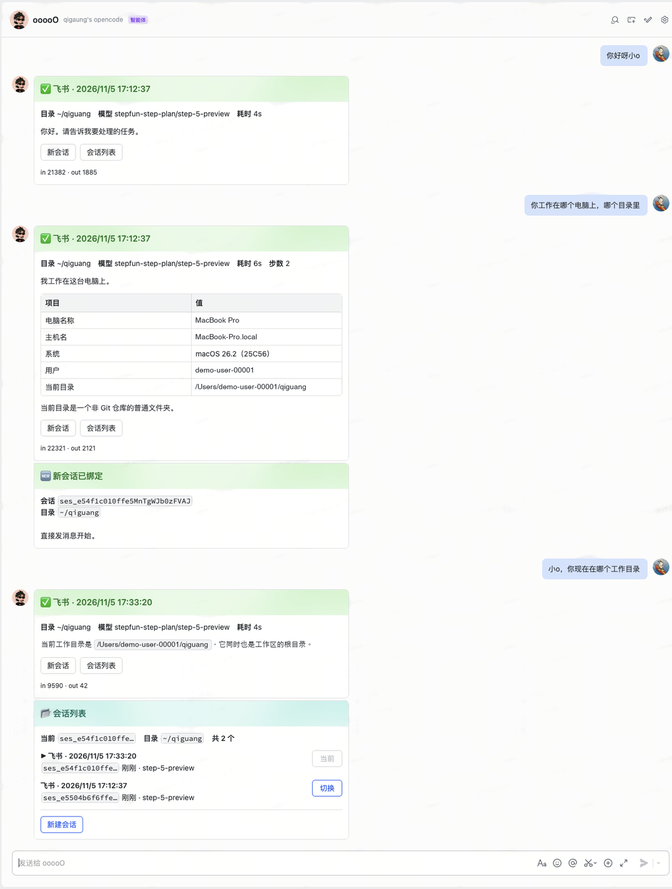
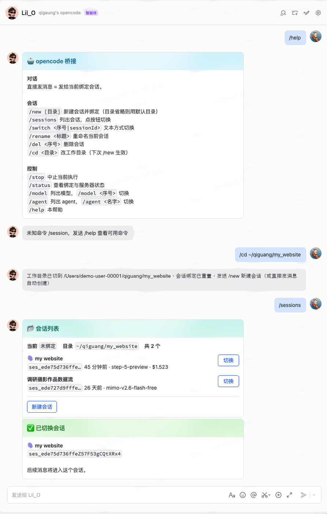

# opencode ⇄ 飞书 桥接

把本机运行的 [opencode](https://opencode.ai) 接到飞书机器人上。在飞书里发一句话，本机 opencode 在你的项目目录里干活，过程和结果流式推回一张飞书卡片。后端可替换，也能把 `pi` 这类一次性 CLI 接成另一个机器人。

适合：agent 装在自己电脑上，想在外面用手机派活、看结论的人；以及想让多个本机 agent 在同一个飞书群里分工协作的人。
不适合：需要云端执行沙箱的场景。

---

## 能力

| 能力 | 说明 |
|---|---|
| 远程下任务 | 飞书里发一句话，本机 opencode 在指定项目目录执行 |
| 多会话 | `/sessions` 出列表点按钮切；`/new` 开新任务。会话按目录隔离 |
| 实时进度 | 卡片流式更新：正文、步数、token、耗时、成本 |
| 富文本 | markdown 表格渲染成真表格，代码块带语法高亮 |
| 权限审批 | opencode 要读 `.env`、动敏感文件时，飞书弹卡片，点允许一次/总是/拒绝 |
| 模型切换 | `/model` `/agent` 在线换，不用重启 |
| 多项目 | `/cd` 换目录，每个目录一份独立会话列表 |
| 群里并行 | 群里每 @ 它一次就在下面开一条话题，一条话题一个会话，多条话题同时跑；只响应 @ 它自己的消息 |
| 免公网 | 走长连接，不需要公网 IP、不需要内网穿透 |
| 可换后端 | `backend.type` 选 `opencode`（流式）或 `pi`（一次性子进程跑完发一张结果卡片）；同一套卡片、中止、僵尸卡收尾逻辑 |

---

## 它长什么样

同一套交互的两个切面。

**左**：发一句话 → 卡片流式回结果。中间那张表是**模型输出的 markdown 表格**，被渲染成了飞书原生表格组件（不是文字）。<br>
**右**：`/cd` 换目录后 `/sessions` 出列表，点「切换」换会话，历史回复原封不动。

<table>
<tr>
<td valign="top"><br>
卡片顶部一行元信息：<b>目录</b> / <b>模型</b> / <b>耗时</b> / <b>步数</b>；底部一行用量：<code>in</code> / <code>out</code> / <code>$</code>。工具调用链路默认不显示，只看结论。</td>
<td valign="top"><br>
会话按目录隔离，列表中只出现当前目录下的会话。每条后面有「已用时长 · 模型 · 累计成本」，点「切换」后新发一条确认卡片。</td>
</tr>
</table>

---

## 快速开始

需要 Node.js 20+，以及装好的 **OpenCode 桌面版**（<https://opencode.ai>）。桥接会用桌面版自带的那份 CLI。

```bash
git clone <这个仓库> && cd opencode-feishu-bridge
npm install
```

`npm install` 只需跑一次。忘了跑也能进下一步（`init` 会跳过凭证验证并提醒你），但启动前必须装。

不需要另外 `npm i -g opencode`。装过的话建议卸掉——两份 opencode 共用同一个会话数据库，混着用会让某些会话突然读不出历史：

```bash
which opencode && npm rm -g @opencode/cli
```

> 为什么用桌面版自带的：桌面版和它的 CLI 是同一个版本、写同一个数据库。混用两个版本会出现「一个版本写入、另一个版本读不出来」，表现为某些会话突然发不出消息。详见 [docs/design-notes.md](docs/design-notes.md#八用哪个-opencode版本一致性)。

### 1. 确认用哪份 opencode

serve 由 `./scripts/up.sh` 自动拉起（第 5 步），它会按这个顺序挑二进制：

```
OPENCODE_BIN 环境变量  →  桌面版自带 CLI  →  PATH 里的 opencode
```

看一眼会选中哪个：

```bash
node scripts/which-opencode.mjs --json
```

如果你的 opencode 不在上述位置，用 `OPENCODE_BIN=/path/to/opencode` 指定即可。

想手动起 serve 也可以（调试用，注意密码要和配置里一致）：

```bash
# "$(node scripts/which-opencode.mjs)" 拿到的就是 up.sh 会用的那份
OPENCODE_SERVER_PASSWORD='my-secret-123' \
  "$(node scripts/which-opencode.mjs)" serve --port 19876 --hostname 127.0.0.1
```

验证：

```bash
curl -s -u opencode:my-secret-123 http://127.0.0.1:19876/api/info
# {"version":"2.2.5","pid":12345,...}
```

> 端口要和配置里的 `opencode.url` 对上，用 4096 也行，改配置即可。

### 2. 创建飞书应用

打开 <https://open.feishu.cn/app> → **创建企业自建应用**（名字随便，比如 `opencode`）。

**2.1 添加机器人能力** ｜ 「添加应用能力」→ 机器人 → 启用。

**2.2 加权限** ｜ 「开发配置 → 权限管理」→ 搜索并添加：

| 权限 | 用途 |
|---|---|
| `im:message` | 收发消息（含更新卡片） |
| `im:message:send_as_bot` | 以应用身份发消息 |
| `im:message.p2p_msg:readonly` | 读用户私聊机器人的消息 |
| `im:message.group_at_msg:readonly` | 读群里 @机器人 的消息 |
| `im:chat:readonly` | 可选，读群信息 |

**2.3 事件订阅** ｜ 「开发配置 → 事件与回调 → 事件配置」→ 订阅方式选 **使用长连接接收事件** → 添加 `im.message.receive_v1`（接收消息）。

**2.4 卡片回调** ｜ 同一页面切到 **「回调配置」** tab → 订阅方式选 **使用长连接接收回调** → 添加 `card.action.trigger`（卡片回传交互）。

> 有些版本的界面把这一项放在「事件配置」里，名字叫「卡片回传交互」，效果一样。**漏了这一步，卡片上的按钮会一直转圈没反应。**

**2.5 发布** ｜ 「版本管理与发布」→ 创建版本 → 申请发布。

- 企业自建应用通常需要管理员审批，通过后机器人才可用。
- 权限变更后必须**重新发版**才生效。

**2.6 拿凭证** ｜ 「凭证与基础信息」→ 复制 **App ID**（`cli_` 开头）和 **App Secret**。

### 配置放在哪

配置目录按这个顺序找，第一个命中的生效：

| 优先级 | 位置 | 什么时候用 |
|---|---|---|
| 1 | `$OCB_CONFIG_DIR` | 一台机器跑多个 agent，每个指一份 |
| 2 | **`.config/opencode-feishu-bridge/`（项目内）** | 存在 `config.json` 就用它，默认推荐 |
| 3 | `~/.config/opencode-feishu-bridge/` | 项目里没有配置时的老位置 |

项目内的目录长这样：

```
opencode-feishu-bridge/
├── config.example.json              ← 模板，入库，只有占位符
└── .config/opencode-feishu-bridge/  ← 首次 npm run init 生成，不入库
    ├── config.json      ← 你的配置（含 appSecret）
    ├── state.json       ← 会话绑定、攒到的名字、未收尾的卡片
    └── bridge.lock      ← 单实例锁
```

> ⚠️ **`.config/` 已经在 `.gitignore` 里，永远不要 `git add -f`。** 里面有 `appSecret`，一旦推上去等于把机器人交给所有人。

这三个文件 clone 下来一个都没有，全都是本机生成的，谁生成、干什么用：

| 文件 | 谁生成 | 什么时候 | 为什么不能入库 |
|---|---|---|---|
| `config.json` | `npm run init`（漏了的话首次 `npm start` 也会生成） | 初始化时 | 含 `appSecret` |
| `state.json` | 桥接自己，第一次有会话绑定时写 | 用完第一次对话 | 里面的 `sessionId` 指向**本机** opencode 的会话，攒到的名字是**本应用**下的 `open_id`，换台机器/换个应用全是废数据 |
| `bridge.lock` | 桥接自己，启动时写、退出时删 | 每次启动 | 里面只有一个 pid。入库后新机器上可能撞上一个活着的 pid，直接被判成「已有实例在跑」而拒绝启动 |

所以 clone 完只剩一件事要做：`npm run init` 填凭证。其余两个文件你不用管，桥接会自己建。

所以 **clone 下来没有 `.config/` 目录是正常的**，不是漏了文件。模板单独放在仓库根的 `config.example.json`（不含任何真实密钥、可安全入库），用一条命令铺开：

```bash
npm run init                                        # 铺到项目内（推荐）
npm run init -- --home                              # 铺到 ~/.config
npm run init -- --app-id=cli_xx --app-secret=yy     # 顺手把凭证填好
```

已经存在 `config.json` 时它不会覆盖，只提示；确实要重来加 `--force`，会先备份成 `config.json.bak`。

思路是「结构入库、密钥不入库」：目录结构和每个字段的含义需要有人告诉你，`config.example.json` 承担这件事；而 `appSecret` 和 `state.json` 只属于这台机器，`.config/` 整体排除最省心——不用逐个文件写例外规则，也就没有「哪天加个新文件忘了 ignore」的风险。

三个入口（`npm start`、`scripts/*.sh`、`scripts/probe-*.mjs`）用的是同一套解析规则，不会出现「命令读 A、桥接读 B」的情况。

### 3. 填配置

```bash
npm run init
```

在终端里跑会进交互向导，问四个问题：

```
App ID: cli_aa265fc890b99bc0
App Secret: ****
验证凭证… ✅ Lil_O
   机器人 open_id ou_26dd…（自动填进 feishu.botOpenId）
你自己的 open_id（可留空，留空则谁私聊机器人都能用）: ou_4c8f…
默认工作目录: /Users/you
```

三件手工做很烦的事它替你做了：

- **输完立刻验证凭证**。填错当场报 `code=10003` 并提示「App ID 和 App Secret 别贴反」，不用等第一次发消息才发现。
- **自动填 `feishu.botOpenId`**。多机器人同群时靠它分辨「@ 的是不是我」，取不到就会退化成「@ 谁都算」，互相抢答。
- **顺手写白名单**。省掉「先跑起来、看日志、再回来改 JSON」那一圈。

不想交互（CI、脚本），用参数：

```bash
npm run init -- --app-id=cli_xx --app-secret=yy   # 只问剩下的
npm run init -- --no-input                        # 只铺模板，什么都不问
```

拿到 open_id 时配置往往已经存在了，为加一个 id 重跑向导太蠢，所以单独给了个命令：

```bash
npm run init -- --add-allow=ou_你的openid
```

生成的 `config.json` 长这样（也可以直接编辑它）：

```json
{
  "feishu": {
    "appId": "cli_a1b2c3d4e5f6g7h8",
    "appSecret": "你的 App Secret",
    "domain": "feishu",
    "allowlist": ["ou_你的open_id"],
    "requireMention": true,
    "botOpenId": "ou_机器人自己的open_id"
  },
  "opencode": {
    "url": "http://127.0.0.1:19876",
    "password": "my-secret-123",
    "defaultDirectory": "/Users/you/project",
    "defaultModel": "stepfun-step-plan/step-5-preview"
  },
  "behavior": {
    "streamIntervalMs": 1800,
    "showReasoning": false,
    "showTools": false,
    "maxBodyChars": 6000,
    "idleTimeoutMs": 900000
  }
}
```

两个必填项：

- **`defaultModel` 一定要填**，格式 `providerID/modelID`。opencode 的默认模型多是 free 模型，部分地区会报 `RegionError: This model is not available in your country`。

  列出可用模型：

  ```bash
  curl -s -u opencode:my-secret-123 http://127.0.0.1:19876/api/model \
    | python3 -c "import sys,json;[print(f\"{m['providerID']}/{m['id']}\") for m in json.load(sys.stdin)['data']]"
  ```

  `npm run doctor` 会校验你填的这个在不在列表里。

- **`allowlist` 强烈建议填**。空数组等于谁私聊机器人都能操作本机的 shell 和文件。填自己的 `open_id`，获取方法：先留空跑起来，给机器人发条消息，控制台日志里会打印「拒绝非白名单用户」，从里面拿到 id，然后用一条命令加进去——不用再去编辑 JSON：

  ```bash
  npm run init -- --add-allow=ou_你的openid
  ```

  向导里也可以直接填，就不用跑这两步。

### 4. 体检

```bash
npm run doctor
```

检查 Node 版本、配置完整性、opencode 连通性、模型是否在列表里、默认目录是否存在。全绿再往下。

### 5. 启动

推荐装成系统服务（登录自启、挂了自动拉起、不依赖任何终端）：

```bash
./scripts/install-agent.sh     # 装一次，之后开机就在跑
./scripts/status.sh            # 看状态：谁在跑、跑了多久、最近日志
./scripts/up.sh                # 重启（作用于 launchd 里的服务）
./scripts/down.sh              # 暂停（下次 up.sh 或下次登录会再起）
./scripts/uninstall-agent.sh   # 彻底卸掉
```

不想装服务也行，老办法照旧：

```bash
./scripts/up.sh       # 启动：同时拉起 serve + 桥接，nohup 后台常驻，写 pid 文件
./scripts/down.sh     # 停止：两个一起停
```

`up.sh` / `down.sh` 会自动识别有没有装 agent，两种模式都能用。

`up.sh` 会读配置里的 `password` 用同样的密码起 serve，不用手动对齐两边。

调试时也可以前台跑，能看到全部日志：

```bash
npm start
```

看到 `✅ 桥接已就绪` 后，飞书里搜机器人名字，私聊发 `/help`。

> **桌面版 App 不需要一直开着。** 桥接用的是 App 装在磁盘上的那份 `opencode-cli`（`~/Library/Application Support/ai.opencode.desktop/cli/<版本>-arm64/`），不是 App 的进程。两个进程各跑各的，实测桥接链路和 App 的 `serve --service` 之间没有任何连接。关掉 App 照样能在飞书里派活；只有在你想亲眼看着它执行、或者接着聊同一个会话时，才需要打开 App。
>
> 反过来要注意：升级桌面版之后，新版本的 CLI 在**新目录**里，正在跑的旧进程不会自己换。`./scripts/down.sh && ./scripts/up.sh` 一次即可。

> **为什么建议用 `install-agent.sh`。** `nohup` 起的进程还挂在某个 shell 的进程组里，那个 shell 退出时可能被一起收掉——表现就是「用着用着机器人不说话了，日志里连报错都没有」。装成 launchd agent 之后，进程归 launchd 管：登录自动起、被杀自动起（实测 kill -9 后 10 秒内恢复），关终端、退出 WorkBuddy 都不影响。

> **不要同时跑两个桥接进程。** 有单实例锁（配置目录下的 `bridge.lock`），第二个会直接报错退出——否则同一条消息会被回两遍。

---

## 怎么用

**一条请求 = 一条消息，只增不改。**

| 你的操作 | 消息怎么动 |
|---|---|
| 发一条消息 | 新开一张卡片承载这次执行，流式在**这张卡内部**更新 |
| 点「会话列表」 | **新发**一条列表卡片，原来那条回复原封不动 |
| 点「切换」/「新会话」/「授权」 | **新发**一条结果卡片，历史回复不动 |
| 在列表里翻页 | 只更新列表卡片自己 |

历史回答永远不会被按钮操作顶掉。卡片内部的流式刷新是例外——那是同一条消息的进度更新。

同一个会话同时只跑一个任务。上一条还在执行时再发消息会被挡回来，提示先等它结束或 `/stop`。

### 群里：一条话题一个会话

私聊只有一个会话，串行就够了。群里按话题拆：

- 在群里 @机器人 发一句话 → 它就在**这条消息下面开一条话题**回复，并为这条话题建一个独立会话
- 再 @ 一条新消息 → 又是一条新话题、又一个会话，两条可以同时跑
- 话题里继续说话**仍然每句都要 @它**，但会接在同一个会话上，不会跑到别的会话去
- 每条话题的 `/new` `/switch` `/stop` 只影响自己这条

相当于在群里开任意多个「并行工作台」，互不串上下文。整机有并发上限 `behavior.maxParallel`（默认 2），超了会直接告诉你当前有几个在跑。

#### @ 判定：只认「@ 我本人」

群里的闸门只看一件事：**这条消息有没有 @ 这个机器人自己**（按 `open_id` 精确比对，来自 `GET /open-apis/bot/v3/info`）。

| 场景 | 会响应吗 | 说明 |
|---|---|---|
| @ 本机器人 | 会 | 唯一会触发的形式 |
| @ 别的机器人 | 不会 | 一个群里可以有多个 agent，各自只认自己 |
| @ 某个同事 | 不会 | `@张三 你看下` 这种不会被当成交给我的活 |
| 什么都没 @ | 不会 | 纯聊天不打扰 |
| 话题里回复但没 @ | 不会 | 仍然要 @，只是会接同一个会话 |
| 私聊 | 会 | 私聊不受 @ 限制 |

被 @ 的如果不是自己，日志会记一行 `[skip] @ 的不是我 names=…`，方便排查「明明 @ 了却没反应」。

**@ 别人时，占位符不会被删掉，而是还原成 `@姓名`。** 所以你发 `@Lil_O @张三 你俩配合下`，模型看到的是 `@张三 你俩配合下` —— 它知道这句话在跟谁说话。这一条在多 agent、多人协作时很关键。

**没 @ 的那条是整条丢弃，不是「先攒着等下一句」。** 判定发生在消息进入处理流程之前（`src/feishu.js` 直接 `return`），所以：

- 不会出现「连续收到两条」
- 也**不会**把没 @ 的那句当成上下文补进去 —— 模型完全看不到它

#### 每条消息都会带一行来源标注

模型拿到的不是光秃秃的一句中文，正文前面会拼一行：

```
[飞书 · 群「桥接话题探针」 · 话题内 · 发送者 ou_c4f80436…（机器人） · 2026/11/5 20:18:05]

@LiLO 你好！
```

三个信息是刻意给的：

- **群名 / 私聊 + 主聊天流 / 话题内** —— 模型不用再去 `ls` 猜自己在哪。实测过没有这行的代价：一次「打个招呼」跑了 9 分 12 秒、48 步，全花在读仓库反推来源上。
- **发送者完整的 `open_id`** —— @ 某人需要对方完整的 open_id，猜不出来。之前模型想 @ 另一个机器人，只能写 `@LiLO` 这种字面量，发出去对方收不到提醒。
- **人 / 机器人** —— 来自事件的 `sender_type`，模型据此知道该用哪种语气、要不要防循环。

群名走 `GET /im/v1/chats/:chat_id`，取到一次就缓存；没开 `im:chat` 权限会静默降级成「群聊」，不影响主干。

**发送者的名字是个坑。** 飞书没有「open_id 反查名字」的通用接口：

| 对象 | 能不能按 open_id 查名字 |
|---|---|
| 人类用户 | 能，但要 `contact:user.base:readonly`；没开会返回 200 但 `name` 字段直接不给 |
| 机器人（应用） | **不能**。通讯录接口对机器人 open_id 直接报 `41050 no user authority` |
| 群成员列表 | 要 `im:chat.members:read`，且不确定是否包含机器人成员 |

所以名字走三层，逐层兜底：

1. **`feishu.names` 人工声明** —— 最准，写好即生效。
2. **群成员列表**（`im:chat.members:read`）—— 开到权限后，遇到不认识的发送者会拉一次整群成员，把所有人的 `open_id → 名字` 一次性存进 `state.json`，之后连接口都不用打。被拒一次就记下 `membersDenied`，不会每条消息都撞 403。
3. **从消息 @ 提及里攒** —— 零权限。每条消息的 `mentions[]` 里都带着被 @ 者的 `name` 和 `open_id`，碰到就记。缺点是得等某个对象被 @ 过一次。

三者都拿不到时，标注里只显示 `open_id`——功能不受影响，只是不好读。

想知道你这边哪条路能走，跑一下：

```bash
npm run probe:names              # 自动挑一个群
npm run probe:names <chat_id>
```

它会分别打「群信息 / 群成员列表 / 通讯录反查」，把每种结果和缺哪个权限直接打出来。

#### 多个 agent 同群时要注意

飞书会把 `im.message.receive_v1` 推给**群里每一个机器人**。所以每个 agent 都必须能精确判断「@ 的是不是我」，否则会出现用户 @A、A 和 B 一起抢答。

本项目的做法是启动时自动取自身 `open_id`。如果取不到（应用没权限等），会退化回「@ 了谁都算」，此时多机器人同群必然抢答 —— 启动日志里会有明确告警，把 `feishu.botOpenId` 填进配置即可解决：

```json
"feishu": { "botOpenId": "ou_xxxxxxxxxxxxxxxxxxxxxxxxxxxxxxxx" }
```

（这个 open_id 就是机器人自己的，可以用 `curl` 打 `/open-apis/bot/v3/info` 看到。）

### 命令

| 命令 | 作用 |
|---|---|
| 直接发文本 | 发给当前绑定会话。没绑定会自动建一个 |
| `/help` | 命令列表 |
| `/new [目录]` | 新建会话并绑定，可指定项目路径 |
| `/sessions` | 会话列表卡片，点「切换」即切 |
| `/switch <序号\|id>` | 文本方式切会话 |
| `/rename <标题>` | 重命名当前会话 |
| `/del <序号>` | 删除会话 |
| `/cd <目录>` | 换工作目录并重置绑定 |
| `/stop` | 中止当前执行 |
| `/status` | 看绑定、模型、tokens、成本 |
| `/model` | 模型列表；`/model <序号>` 切换 |
| `/agent` | Agent 列表；`/agent <名字>` 切换 |

别名：`/ls` = `/sessions`，`/use` = `/switch`，`/abort` = `/stop`，`/delete` = `/del`，`/?` = `/help`。

---

## 卡片能显示什么

模型输出的 markdown 会被拆开，分别落到合适的飞书组件上：

| Markdown 语法 | 显示效果 |
| --- | --- |
| 表格 | 原生表格，表头灰底、可对齐；超过 10 行飞书内部分页 |
| 围栏代码块 | 带语法高亮的代码块 |
| `## 标题` | 加粗（飞书正文不支持真正的标题层级） |
| `- 列表` / `> 引用` | 圆点列表 / 去掉引用符号的正文 |
| 加粗、斜体、行内代码、链接 | 原样支持 |

几点使用上的注意：

- 单张卡片上限 30KB，所以超大表格会被裁剪：最多 50 行 8 列，超出会提示还剩多少内容。
- 流式过程中表格写到一半（只有表头、分隔行还没出来）会先显示成 `a ｜ b` 的样子，写完就变回真表格，属正常现象。
- 卡片上的表格是组件，能翻页但点不了排序。
- 工具调用链路默认不显示，只看结论。想看轨迹改 `behavior.showTools: true` 重启；完整轨迹在电脑上的 opencode 里。
- 卡片分三段：**前缀**（目录 / 模型 / 耗时 / 步数）│ **正文**（模型输出）│ **后缀**（用量/帮助那行 + 按钮）。只在前缀和正文之间画一条分割线——正文自己是整块 markdown，跟元信息糊在一起最难读；正文结尾本来就有留白，再往按钮前塞一条线会把卡片切得太碎。
- 后缀顺序是**先按钮后小字**：上面是「新会话 / 会话列表」，下面一行 `in 66636 · out 9509 · $0.01｜@我 并发送 /help 查看全部命令`（`｜` 前后不留空格）。群里必带「@我 并发送」，私聊只写「发送」。按钮只覆盖三个高频动作，`/model` `/cd` `/switch` 这些不看帮助是发现不了的，所以入口必须摆出来。
- **金额是 `$0.00` 不代表没取到**。stepfun 这类套餐型 provider 在 `/api/model` 里把 `cost.input/output/cache` 全填 0，opencode 如实报 0。换一个按量计费的模型就能看到真实数字。卡片上的金额统一保留两位小数。

---

## 配置项

| 键 | 说明 | 默认 |
|---|---|---|
| `feishu.appId` / `appSecret` | 飞书应用凭证 | — |
| `feishu.domain` | `feishu` 或 `lark`（国际版） | `feishu` |
| `feishu.allowlist` | open_id 白名单，空 = 不限制（不建议） | `[]` |
| `feishu.requireMention` | 群聊是否必须 @ **本机器人** 才响应 | `true` |
| `feishu.botOpenId` | 机器人自己的 open_id。留空则启动时自动向飞书取；多机器人同群建议显式填 | `""` |
| `feishu.names` | `open_id → 显示名`，只影响来源标注里显不显示名字。留空则从消息 @ 提及里自动攒 | `{}` |
| `opencode.url` | serve 地址 | `http://127.0.0.1:19876` |
| `opencode.password` | 与 `OPENCODE_SERVER_PASSWORD` 一致；serve 没设密码就留空 | `""` |
| `opencode.defaultDirectory` | `/new` 不带目录时用这个 | `$HOME` |
| `opencode.defaultModel` | `providerID/modelID`，**建议必填** | `""` |
| `behavior.streamIntervalMs` | 卡片刷新间隔，别低于 1200（飞书 patch 有频率限制） | `1800` |
| `behavior.showReasoning` | 是否把模型思考过程推到卡片 | `false` |
| `behavior.showTools` | 是否展示工具调用链路 | `false` |
| `behavior.maxBodyChars` | 卡片正文最大字符数，超出保留尾部 | `6000` |
| `behavior.idleTimeoutMs` | 多久没收到事件就判定卡死并收尾卡片；设 0 关闭 | `900000`（15 分钟） |
| `behavior.maxParallel` | 同时最多跑几个任务（群里每话题一个会话，彼此并行）；0 = 不限 | `2` |
| `backend.type` | `opencode`（默认，常驻 HTTP + SSE）或 `pi`（一次性子进程） | `opencode` |
| `backend.pi.bin` | pi CLI 路径，留空用 PATH 里的 `pi` | `pi` |
| `backend.pi.model` | 传给 `--model`，留空用 pi 自己的默认 | `""` |
| `backend.pi.timeoutMs` | 单次执行超时 | `600000` |
| `backend.pi.extraArgs` | 额外启动参数，如 `["--no-extensions"]` | `[]` |

环境变量可覆盖同名项：`FEISHU_APP_ID` `FEISHU_APP_SECRET` `OPENCODE_URL` `OPENCODE_SERVER_PASSWORD` `BRIDGE_DEFAULT_DIR` `BRIDGE_DEFAULT_MODEL` `BRIDGE_ALLOWLIST`（逗号分隔）。多实例相关的 `OCB_CONFIG_DIR` `OCB_INSTANCE` `OCB_BACKEND` `OCB_PI_BIN` `OCB_PI_MODEL` 见下一节。

`OPENCODE_BIN` 单独一条：指定 `up.sh` 用哪个 opencode 可执行文件，不填就按「桌面版自带 CLI → PATH」的顺序找。

---

## 多后端与多机器人

一个进程只服务一个机器人。想让三个 agent 同群协作，就是**三个飞书应用 + 三份配置 + 三个进程**，各自只认「白名单用户 @ 我本人」的消息。

### 把 pi 接成第二个机器人

1. 飞书开放平台新建一个应用，拿到它自己的 `appId` / `appSecret` / `botOpenId`，权限和事件订阅照「创建飞书应用」一节再来一遍；
2. 复制一份配置到新目录，改这些字段：

```json
{
  "backend": { "type": "pi", "pi": { "bin": "pi", "model": "", "timeoutMs": 600000, "extraArgs": [] } },
  "feishu": { "appId": "cli_<新应用>", "appSecret": "...", "botOpenId": "ou_<新机器人>", "allowlist": [], "names": {} }
}
```

3. 装成常驻服务（**只有 opencode 那个实例需要 `opencode serve`**，pi 实例会自动跳过）：

```bash
./scripts/install-agent.sh --instance pi --config-dir "$HOME/.config/opencode-feishu-bridge-pi"
OCB_INSTANCE=pi npm run status
OCB_INSTANCE=pi npm run up      # 之后重启、查看都要带同一个 OCB_INSTANCE
```

`OCB_CONFIG_DIR` 决定读哪份配置，`OCB_INSTANCE` 决定 launchd 服务名。缺省实例的服务名保持原样，老部署不用改任何东西。`bridge.lock` / `state.json` / `pi-sessions` 全在各自配置目录下，多个实例互不干扰。

### 一次性模式下什么变了

`pi -p --mode json` 跑完才出结果，所以卡片是「执行中 → 跑完一次性更新成结果」两张状态，中途不刷新正文。除此之外和 opencode 后端一致：分割线、`in / out / $金额｜@我 并发送 /help`、中止按钮、僵尸卡收尾都在。

没有的：工具调用轨迹、思考过程、交互式权限卡片、`/agent`（pi 没有 opencode 的 agent 概念）。`/sessions` 列的是该实例的 pi 会话文件，`--session-id` 保证同一话题里能续聊。

### 已知风险

**机器人之间互 @ 目前没有轮次护栏。** 群里已经出现过两个机器人互相 @ 连聊好几轮的情况，现在靠模型自己判断「不用回了」才停。三个 agent 一起跑之前建议先补上「同一话题连续 N 轮机器人→机器人就停，人类发言重置」的闸门。

另外：卡片正文里写 `@名字` 只是字面字符，不产生飞书提醒；要叫醒另一个 agent 必须发真正的 `<at user_id="ou_...">`。

设计取舍、pi 输出格式实测、后续 dsh 的接法见 [docs/pi-backend.md](docs/pi-backend.md)。

---

## 排障

| 现象 | 排查方向 |
|---|---|
| 启动报 `连不上 opencode serve` | serve 没起，或端口/密码不对。先 `curl -u opencode:密码 http://127.0.0.1:19876/api/info` |
| 报 401 | `opencode.password` 和 serve 的密码不一致。用 `up.sh` 起会按配置对齐；手起 serve 时注意 |
| 飞书发消息没反应 | 应用没发布 / 权限没审批通过 / 事件订阅没选「长连接」 |
| 按钮点了转圈没返回 | 「回调配置」里没加 `card.action.trigger` |
| 群聊不回 | 没 @ 到**它本人**（@ 了别人、或只 @ 了另一个机器人都不算），或没把机器人拉进群 |
| 报 `RegionError` | `defaultModel` 用了当前地区不可用的模型，换一个 |
| 某个会话一直发不出消息，1 秒内就失败，错误里有 `Failed to decode message` | 这个会话的历史里有另一个 opencode 版本写入、当前版本读不出的记录。先 `npm run doctor` 看 serve 和本地 CLI 版本是否一致，一致仍报错见 [design-notes 第九节](docs/design-notes.md#opencode-升级后的历史数据兼容问题) |
| 卡片不更新 | `streamIntervalMs` 设太低被限流，调回 1800 |
| 卡片一直停在「执行中」 | 两种情况：① 事件流断了但进程还活着 —— 看 `logs/bridge.log` 有没有「事件流断开」，`idleTimeoutMs` 到期会自动转失败；② 桥接在执行途中重启过 —— 下次启动会把遗留卡片标成「已中止」（靠 `state.json` 的 `inflight` 记录），老版本留下的卡片没有记录，只能手动重发 |
| 同一条消息回两遍 | 跑了两个桥接实例。`./scripts/down.sh` 全停再 `./scripts/up.sh` |
| 机器人突然不说话了，日志里也没报错 | 进程被外部杀了（nohup 起的常见）。`./scripts/status.sh` 看是不是没了；装 `install-agent.sh` 之后不需要管这个 |
| 群里 @ 了但机器人不理会 | 先看 `logs/bridge.log`：有 `[skip] @ 的不是我` 说明闸门挡住了（多机器人同群常见）；什么都没有说明事件没进来，查飞书后台的事件订阅 |
| 想并行但提示「已经有 N 个任务在跑」 | 到 `behavior.maxParallel` 上限了。本机跑得动可以调到 3–4，不建议更高 |

日志：前台跑打在 stdout，后台跑看 `logs/bridge.log`。

---

## 已知限制

1. **只处理文本消息。** 图片、文件、语音会回一句「暂不支持」。
2. **同一会话任务串行。** 上一条没结束，新消息会被拒绝，不会排队。
3. **卡片更新有 1~2 秒间隔**，不是逐字打字机效果。飞书 patch 接口有频率限制，调快会被限流。
4. **桥接进程必须活着。** 合盖休眠、断网、退出终端，机器人都失效。要真常驻得配 launchd 或找台常开的机器。
5. **同一条话题里的所有人共用一个绑定。** 按话题隔离，不按人隔离。

---

## 验证安装是否正常

不接飞书也能跑通整条链路：

```bash
npm run dry
```

终端 REPL，把飞书换成 stdin，卡片打成 ASCII 框。创建会话、流式事件、卡片渲染、命令全部跟真机一致。

带真实模型的集成自测（需要 serve 在跑）：

```bash
npm run selftest -- --model stepfun-step-plan/step-5-preview
```

会真实建会话、发 prompt、删会话，覆盖 serve 连通、状态持久化、流式聚合、增量 patch、历史消息不被覆盖、全部命令、卡片回调、白名单拦截、话题内回复、@ 判定。

---

## 适合改代码的人

```
飞书 App
  │ ① WebSocket 长连接  ← 收事件（im.message.receive_v1 / card.action.trigger）
  │ ④ HTTPS REST        → 发/改卡片（im/v1/messages create / patch）
  ▼
src/feishu.js   长连接与收发（@larksuiteoapi/node-sdk，自动续 tenant_access_token）
  ▼
src/handler.js  命令分发、会话绑定、prompt 下发、卡片回调
  │   └── src/store.js   chat_id → { sessionId, directory }
  ▼
src/oc.js       opencode v2 HTTP API + SSE 事件流（自动重连）
  ▼
opencode serve（桌面版自带 CLI）  →  本地项目目录
```

两个关键设计：`/api/session` 建会话时带 `location.directory`，所以一个 serve 就能服务任意多个项目；事件流每条都带 `sessionID`，按它过滤只刷新对应那张卡片。

```
src/md.js      Markdown → 飞书卡片元素（表格/代码块/标题/列表分段解析）
src/cards.js   卡片模板（card 2.0）
src/render.js  事件 → 运行态聚合
src/which-opencode.js  选哪份 opencode 二进制（up.sh 与 doctor 共用）
scripts/       体检、自测、卡片探针、端到端验证
```

设计取舍、踩过的平台坑、以及为什么不用现成方案，见 [docs/design-notes.md](docs/design-notes.md)。
